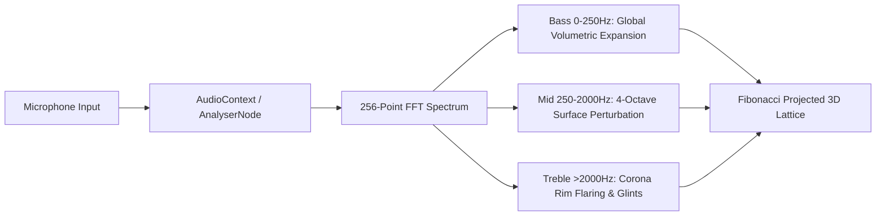
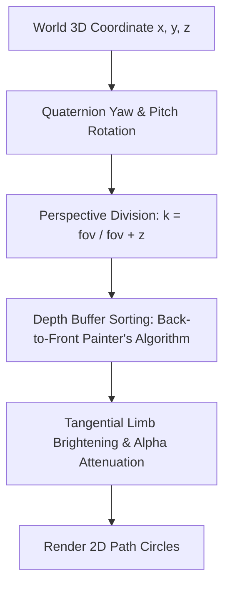

# TARKA | Particle Intelligence Engine & 3D Fibonacci Lattice

## Architectural Overview

The central interactive element of TARKA's voice-first interface is the **TarkaParticleOrb**, an 8,800-point 3D spherical particle system rendered via an HTML5 2D Canvas context with hardware-accelerated projection mathematics.

Located in: `frontend/src/v6/voice/TarkaParticleOrb.tsx`

---

## 1. Mathematical Lattice Geometry

The sphere vertices are distributed uniformly across the 3D surface using spherical Fibonacci phyllotaxis (Golden Spiral distribution), preventing polar clustering and ensuring isotropic vertex density:

$$\theta_i = \arccos\left(1 - \frac{2(i + 0.5)}{N}\right), \quad \phi_i = \pi (1 + \sqrt{5}) \cdot i$$

$$x_i = R \sin\theta_i \cos\phi_i, \quad y_i = R \sin\theta_i \sin\phi_i, \quad z_i = R \cos\theta_i$$

Where:
- $N = 8,800$ particles in standard high-performance mode.
- $N = 2,200$ particles when `prefers-reduced-motion` is active.
- $R \approx 135\text{px}$ to $230\text{px}$ dynamically modulated by low-frequency audio energy.

---

## 2. Multi-Octave Acoustic Perturbation

The orb reacts in real-time to audio input passed from the `TarkaVoiceEngine` via an 8-bit Fast Fourier Transform (`Uint8Array`) buffer:



### 2.1 Band Breakdown
1. **Low Frequency (Bass: 0 – 250 Hz)**: Modulates base radius expansion $R(t) = R_0 \cdot (1 + 0.42 \cdot \text{RMS})$.
2. **Mid Frequency (Vocal Core: 250 – 2,000 Hz)**: Drives 4-octave sinusoidal surface displacement:
   $$\Delta r_i = A_1 \sin(3\theta + 2\phi + \omega_1 t) + A_2 \sin(7\theta - 4\phi + \omega_2 t) + A_3 \sin(13\theta + 8\phi + \omega_3 t)$$
3. **High Frequency (Treble: > 2,000 Hz)**: Induces electric corona rim flaring, sparking high-intensity glints across outer tangent vertices.

---

## 3. Projection & Optical Shading Pipeline



### 3.1 Depth Sorting & Occlusion
To achieve physical translucency without Z-buffer depth artifacts, all projected particles are sorted back-to-front based on their rotated $z'$-coordinate:
```typescript
sortedIndices.sort((a, b) => transformedZ[b] - transformedZ[a]);
```

### 3.2 Porcelain & Neural Optical Shading
- **Core Particles**: Rendered in warm ivory (`#F8F4ED` / `#FFFDF8`) with radial gradient soft fills.
- **Limb Brightening**: Particles near the tangential horizon of the sphere undergo optical Fresnel brightening, creating a glass-like glowing boundary.
- **Neural State Tinting**: When the assistant is processing or speaking, particles transition into deep neural sapphire (`#476D91`), warning amber (`#A66A17`), or error crimson (`#B6423B`).

---

## 4. Hardware Safety & Performance Budgets

1. **DPR Clamping**: `window.devicePixelRatio` is capped at $2.0$ to prevent fillrate exhaustion on 4K/Retina displays.
2. **Animation Frame Throttling**: Frame delta is monitored; if frame time exceeds 24ms, particle count dynamically subsamples to maintain a smooth 60 FPS.
3. **Reduced Motion Compliance**: Automatically detects `window.matchMedia('(prefers-reduced-motion: reduce)')`, halting rotational velocities and dampening displacement amplitude by 85%.

