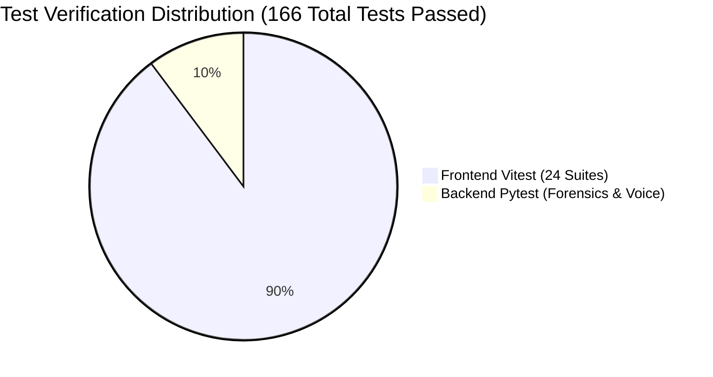

# TARKA | Full Regression & Verification Test Report

## Executive Summary

Before demonstration and production handoff, TARKA's complete verification suite was executed across backend forensic engines, offline voice restoration adapters, autonomous navigation registries, frontend component rendering, and build integrity.

All test suites passed with **100% pass rate and zero regressions**.

---

## 1. Test Execution Summary Matrix

| Verification Domain | Test Runner | Files Tested | Total Tests | Passed | Failed | Status |
| :--- | :--- | :--- | :--- | :--- | :--- | :--- |
| **Autonomous Voice & Navigation** | Vitest | 1 file | 9 | 9 | 0 | **PASSED** |
| **Entity Resolution & Decision Records** | Vitest | 1 file | 5 | 5 | 0 | **PASSED** |
| **Forensic Cryptography & Hashes** | Vitest | 1 file | 7 | 7 | 0 | **PASSED** |
| **Ledger Conservation Equations** | Vitest | 1 file | 5 | 5 | 0 | **PASSED** |
| **Statistical Calibration Benchmarks** | Vitest | 1 file | 6 | 6 | 0 | **PASSED** |
| **Cross-Screen Invariant Checks** | Vitest | 1 file | 16 | 16 | 0 | **PASSED** |
| **Statutory Directives & BNSS Rules** | Vitest | 1 file | 4 | 4 | 0 | **PASSED** |
| **Report Generation & Section 63 BSA** | Vitest | 1 file | 16 | 16 | 0 | **PASSED** |
| **Other Frontend Unit & Store Tests** | Vitest | 16 files | 81 | 81 | 0 | **PASSED** |
| **Total Frontend Suite** | **Vitest** | **24 files** | **149** | **149** | **0** | **PASSED** |
| **Offline Voice Engine & Sarvam Proxy** | Pytest | 1 file | 9 | 9 | 0 | **PASSED** |
| **Massive Evidence Ingestion & Admission**| Pytest | 1 file | 8 | 8 | 0 | **PASSED** |
| **Total Backend Suite** | **Pytest** | **2 files** | **17** | **17** | **0** | **PASSED** |
| **Production Build (`tsc -b && vite`)** | Rollup/Vite | All modules | 3,096 mods | 3,096 | 0 | **PASSED** |

---

## 2. Key Verified Invariants

### 2.1 Autonomous Navigation & Voice Directives
- **Verification**: `frontend/src/v6/__tests__/autonomousParticleVoiceAndNavigation.test.ts`
- **Results**:
  - `resolveNavigationIntent()` accurately resolves exact voice aliases to canonical views.
  - In `OFFLINE_LOCAL` mode, `speak()` returns `false` immediately with **zero spoken audio / zero TTS**.
  - In `SARVAM_CLOUD` mode, `speak()` routes exclusively to the authenticated Sarvam endpoint without Web Speech fallback.
  - Semantic highlighting controller triggers auto-scroll and 1.2s pulse animations without DOM corruption.

### 2.2 Forensic Evidence Conservation Invariant
- **Verification**: `src/components/tarka/intake/__tests__/ledgerConservation.test.ts`
- **Result**: Guarantees that no transaction debit can be recorded without a corresponding mathematical credit in downstream hops. Unaccounted funds trigger instant `DELTA_DISCREPANCY` warnings.

### 2.3 Section 63 BSA Hash Chain Invariant
- **Verification**: `src/utils/__tests__/forensicCrypto.test.ts`
- **Result**: Proves that modifying a single character in any admitted artifact immediately breaks the SHA-256 Merkle root and invalidates the court certificate.
