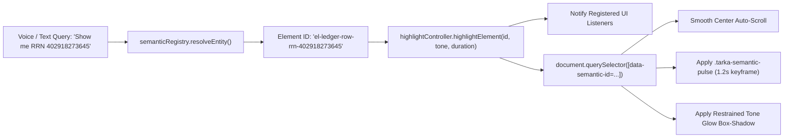

# TARKA | Universal Semantic Highlighting & Restrained RGB Accents

## Overview

When an investigator asks a forensic assistant a question such as:
> *"Where is the primary disputed transaction in the ledger?"* or
> *"Which node represents the first-hop mule aggregator?"*

The system must not only respond verbally or in text, but must also **visually illuminate the exact entity on screen**. TARKA implements a pub/sub **Universal Semantic Highlighting System**.

Located in:
- Registry & Controller: `frontend/src/v6/highlight/semanticRegistry.ts`
- CSS Definitions: `frontend/src/v6/styles/v6-tokens.css`

---

## 1. Architecture of the Semantic Registry



---

## 2. Restrained Skeuomorphic Tone Palette

In accordance with TARKA's tactile command centre aesthetics, highlights do not use loud, flashing neon colors. Instead, they apply restrained, calibrated RGB edge-glows that enhance legibility:

| Semantic Tone | Hex Color | Glow Spread | Semantic Meaning |
| :--- | :--- | :--- | :--- |
| `neural` | `#476D91` | `rgba(71, 109, 145, 0.45)` | AI focus target, navigation destination, informational metric |
| `warning` | `#A66A17` | `rgba(166, 106, 23, 0.45)` | Disputed transaction, timestamp mismatch, unverified claim |
| `error` | `#B6423B` | `rgba(182, 66, 59, 0.50)` | Mule aggregator hub, fraud ring node, critical discrepancy |
| `success` | `#287653` | `rgba(40, 118, 83, 0.45)` | Section 63 BSA certificate valid, frozen funds secured |

---

## 3. Registered Semantic Target Catalog

Key elements across the application are tagged with permanent `data-semantic-id` attributes:

```html
<!-- Example in Evidence Ledger -->
<tr
  data-semantic-id="el-ledger-row-rrn-402918273645"
  class="tarka-semantic-target"
>
  <td>402918273645</td>
  <td>HDFC Core</td>
  <td>₹1,45,000</td>
</tr>
```

### 3.1 Primary Element Registry
1. `el-metric-total-loss`: Total loss overview metric card on Command Centre.
2. `el-metric-recoverable-pool`: Immediate recoverable balance pool card.
3. `el-ledger-row-rrn-402918273645`: Primary fraudulent debit of ₹1,45,000 in Evidence Ledger.
4. `el-ledger-metric-conservation`: Conservation equation status indicator.
5. `el-graph-node-mule-1`: Primary mule aggregator node in Fraud Network Graph.
6. `el-device-cgnat-funnel`: CGNAT port allocation table in Device & SIM Telemetry.
7. `el-court-proof-certificate`: Statutory Section 63 BSA Certificate card on Court Ready screen.
