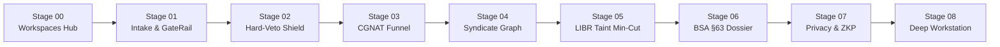

# TARKA: EXECUTIVE TL;DR
**Evidence-Centred Cyber Fraud Investigation and Attribution Workbench**  
**Competition Target:** SUTRAM 2026 — Problem Statement 04 (PS04)  
**Governing Doctrine:** AI PROPOSES. EVIDENCE VERIFIES. HUMAN DECIDES.  
**Audience:** Academic Faculty Mentors, Senior Cybersecurity Researchers, Forensic Technical Leads  
**Document Status:** Verified Against Actual Repository Implementation (`C:\PROJECTS\tarka_v5_clean_verify`)

---

## 1. WHAT IS TARKA?

**TARKA** is a specialized, evidence-centred cyber-fraud investigation and attribution workstation built specifically to solve the acute evidentiary fragmentation that paralyzes cyber-crime investigations across India's digital financial infrastructure (UPI, IMPS, AEPS, RTGS, and Core Banking Systems).

Unlike conventional analytics dashboards or probabilistic fraud-scoring tools that attempt to predict crime using black-box machine learning, TARKA operates on a strict evidentiary doctrine:

$$\mathbf{AI\ PROPOSES.\quad EVIDENCE\ VERIFIES.\quad HUMAN\ DECIDES.}$$

- **AI PROPOSES:** Automated algorithmic heuristics, streaming correlation engines, and large-language-model extractors propose investigative leads, hypothesize money-mule clusters, and flag anomalies across heterogeneous data sources.
- **EVIDENCE VERIFIES:** Mathematical formal verification (Microsoft Z3 SMT Theorem Prover v5.1.0) and immutable cryptographic hashing (SHA-256 Content-Addressable Storage) rigorously check proposed assertions against hard mathematical invariants (such as double-entry ledger conservation, carrier-grade NAT port conservation, and monotonically advancing physical clocks). If a claim fails mathematical consistency, it is strictly falsified and quarantined.
- **HUMAN DECIDES:** The workbench strictly prohibits automated guilt assignment, automatic identity merging, or autonomous freezing orders. Final attribution, lien mandates, and statutory filings remain exclusively under the authenticated legal seal of the Investigating Officer (IO) or Magistrate.

---

## 2. THE PROBLEM BEING ADDRESSED

Modern financial cyber-fraud in India (e.g., Digital Arrest extortion, Telegram investment scams, APK-based SIM swapping, and mule-account syndicates) routinely exploits institutional seams between disparate agencies:

1. **Fragmented Digital Evidence:** Police receive isolated extracts—a victim bank statement (PDF/Excel), a telco IPDR log (CSV), an NPCI central switch XML record, and WhatsApp extortion chats. Today, these are reconciled manually across disjointed spreadsheets.
2. **Financial Inconsistencies & Falsified Statements:** Fraudsters and dishonest complainants frequently doctor transaction balances or submit altered PDFs with multiple incremental `%%EOF` cross-reference trailers.
3. **The 340-to-1 CGNAT Attribution Bottleneck:** Indian telecom providers (Airtel, Jio, Vi) map hundreds of mobile subscribers behind a single public IPv4 address using Carrier-Grade NAT (CGNAT). Without exact source-port correlation and sub-second timestamp synchronization, attributing an IP address to a physical subscriber is statistically impossible and leads to wrongful targeting.
4. **Timestamp Drift & Unsynchronized Clocks:** Banking servers (UTC), telecom RADIUS servers (IST), victim mobile phones, and Wi-Fi routers operate with uncalibrated internal clock skew, causing temporal inversion where downstream debit records appear before upstream victim debits.
5. **Entity Resolution Risks & Collateral Damage:** Naive graph clustering frequently merges innocent merchants (e.g., petrol pumps, grocery stores) with money mules merely due to high transaction volume, leading to illegal freezing of legitimate commercial working capital under Section 106/107 BNSS.
6. **Evidentiary Lineage & Courtroom Admissibility:** Under Section 63 of the Bharatiya Sakshya Adhiniyam, 2023 (BSA, replacing Section 65B of the Indian Evidence Act), electronic records submitted to courts must have an unbroken cryptographic chain of custody, device hash verification, and operating integrity certification.

---

## 3. CORE IMPLEMENTED CAPABILITIES AT A GLANCE

The current working repository (`tarka_v5_clean_verify`) implements an operational 8-stage forensic pipeline backed by formal methods and cryptographic integrity:

1. **Multi-Vector Evidence Intake & Falsification Gate (GateRail I1–I5):** Evaluates incoming artifacts against progressive integrity gates. Features native double-entry ledger balance conservation checking and PDF incremental xref trailer tamper detection.
2. **Entity Extraction & Hard-Veto Shield:** Extracts phone numbers, PANs, Aadhaar tokens, UPI IDs, and GSTINs. Implements a deterministic Hard-Veto rule that halts identity merging when permanent statutory identifiers conflict, regardless of graph similarity scores.
3. **CGNAT Dynamic Port Funnel ($340 \rightarrow 1$):** Performs 4-hop mathematical set intersection ($S_1 \cap S_2 \cap S_3 \rightarrow 1$) across telecom NAT translation tables, isolating the unique subscriber behind shared IP infrastructure.
4. **Fraud Syndicate Network & Tethering Detection:** Force-directed and radial hierarchy graph projections uncover scatter-gather diamond patterns ($A \rightarrow \{B_1, B_2\} \rightarrow C$) and detect Wi-Fi hotspot tethering through packet Time-to-Live analysis ($TTL = 63$).
5. **LIBR Proportional Debit Lien Engine:** Implements the landmark *Roscoe v. Winder* Lowest Intermediate Balance Rule (LIBR) to calculate lawful freezing liens while carving out clean commercial capital.
6. **Statutory BSA 2023 §63 Dossier Exporter:** Compiles dual-seal Part-A electronic evidence certificates, Part-B chain-of-custody logs, and court-ready binary PDFs.
7. **Privacy, Cryptography & Formal Verification:** Employs ECDH Private Set Intersection, 4-node PBFT consensus simulation, and Microsoft Z3 SMT solver invariants.
8. **Forensic Deep Workstation:** Features the **Temporal Evidence Loom** (multi-track chronological scrubber), the **Claim Dependency Lens** (Leave-One-Out claim ablation), and the **Investigation Flight Recorder** (cryptographically chained JSONL audit ledger).
9. **Benchmark & Diagnostics Lab:** Browser-based high-throughput streaming engine evaluating 6 forensic engines against public datasets (PaySim, IBM AML) and synthetic 5-file Indian fraud packs.

---

## 4. WHAT TARKA CAN AND CANNOT ESTABLISH

| Dimension | What TARKA Genuinely Establishes | What TARKA Does NOT Establish |
| :--- | :--- | :--- |
| **Ledger Integrity** | Double-entry balance conservation violations ($\sum \text{Debit} \neq \Delta \text{Balance}$) down to ₹0.01 precision. | Cannot verify internal database state of a live bank without an authorized direct API feed. |
| **PDF Authenticity** | Detects multiple `%%EOF` markers, injected xref tables, and post-generation visual tampering. | Cannot guarantee a single-trailer PDF was not created fraudulently on an original PDF writer. |
| **Telecom Attribution** | Proves mathematical set convergence ($340 \rightarrow 1$) when valid IPDR and source port records exist. | Cannot verify who physically held the mobile handset during the session without physical custody. |
| **Clock Synchronization** | Quantifies clock drift and proves whether transaction sequences violate causality via Z3 SMT. | Cannot physically reset uncalibrated remote clocks; it mathematically bounds the uncertainty window. |
| **Attribution & Guilt** | Establishes graph proximity, shared hardware IMEI/BSSID anchors, and money flow trails. | **Does NOT determine criminal intent, mens rea, or guilt.** Final legal determination requires judicial trial. |
| **Legal Admissibility** | Generates verifiable Section 63 BSA compliance hashes and custodial chain-of-custody logs. | Cannot replace the mandatory physical signature or sworn affidavit of the authorized forensic examiner. |

---

## 5. REPOSITORY TECHNOLOGY STACK SUMMARY

- **Frontend Application:** React 18.2.0, Vite 5.1.4, TypeScript 5.3.3, Tailwind CSS with Space-Grade Obsidian Glass design tokens, Lucide Icons, Radix UI primitives, Recharts, D3/ElkJS graph layout engines.
- **Backend Application:** Python 3.12.1, FastAPI 0.110+, Uvicorn ASGI runner, Pydantic v2 data models.
- **Formal Verification Engine:** Microsoft Z3 Theorem Prover (`z3-solver` v5.1.0).
- **Cryptographic Algorithms:** SHA-256 content-addressing, BIP-39 mnemonic seals, PGP biometric phonetic word lists, HMAC-SHA256 chained audit logs.
- **Persistence & Fallback:** PostgreSQL 16 / SQLite transactional authority, filesystem Content-Addressable Storage (CAS), memory/sqlite graph projection engine with graceful degradation when external clusters are offline.

