# TARKA: SCREEN-BY-SCREEN TECHNICAL DOCUMENTATION
**Exhaustive Forensic Interface Inventory, Control Matrix, Workflow Analysis & Visual Evidence**  
**Repository Working Directory:** `C:\PROJECTS\tarka_v5_clean_verify`  
**Governing Doctrine:** AI PROPOSES. EVIDENCE VERIFIES. HUMAN DECIDES.  
**Audience:** Academic Reviewers, Forensic Engineers, Legal Technology Evaluators  

---

## NAVIGATION ORDER & SCREEN INDEX

The TARKA workstation organizes cyber-fraud investigations into an operational multi-case command hub and an 8-stage forensic pipeline:

```
[Alt+0 / Alt+W] Station Command & Workspaces Hub
    │
    ├── [Alt+1] Stage 01: Multi-Vector Intake & Falsification Gate
    ├── [Alt+2] Stage 02: Entity Extraction & Hard-Veto Shield
    ├── [Alt+3] Stage 03: CGNAT Attribution & SIM-Swap Funnel
    ├── [Alt+4] Stage 04: Fraud Network & Actor Attribution
    ├── [Alt+5] Stage 05: LIBR Proportional Debit Lien Engine
    ├── [Alt+6] Stage 06: BSA §63 Evidence Certificate Dossier
    ├── [Alt+7] Stage 07: Privacy, Cryptography & Formal Verification Hub
    └── [Alt+8] Stage 08: Deep Forensic Instrumentation (Workstation Hub)
           ├── Tab 1: Temporal Evidence Loom
           ├── Tab 2: Claim Dependency Lens
           ├── Tab 3: Investigation Flight Recorder
           └── Tab 4: Provenance DAG Lineage
    │
[Alt+B / Alt+D] Benchmark & Diagnostics Lab (High-Throughput Streaming Studio)
```

---

## SCREEN 00: STATION COMMAND & WORKSPACES HUB

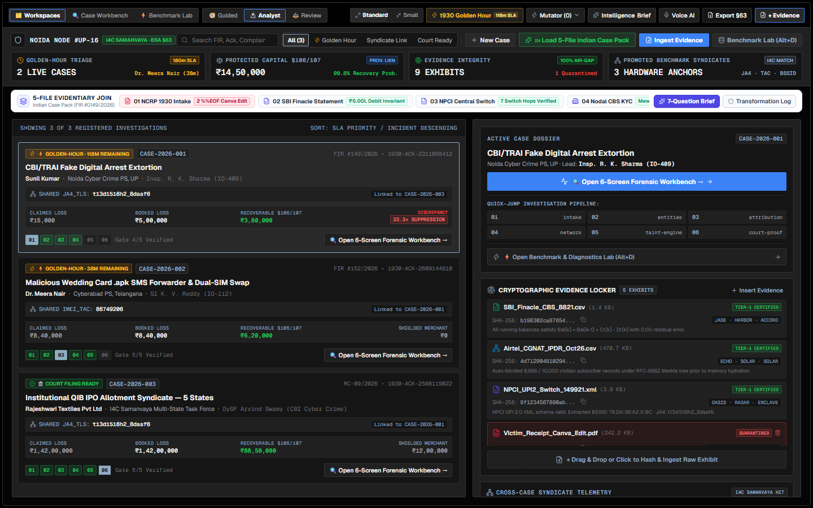

### Purpose
Provides multi-case command and triage across active cyber-crime FIRs and NCRP 1930 complaints, monitoring statutory golden-hour deadlines, protected commercial capital, and cross-case syndicate links.

### What an Investigator Sees
An executive command surface featuring:
1. Top Global Navigation Bar with active investigation mode (`Guided`, `Analyst`, `Review`), density controls (`Standard`, `Small`), Live Judge Mutator ribbon toggle, 7-Question Intelligence Brief button, Sarvam Voice AI trigger, and Section 63 BSA Quick Export.
2. 4 High-Priority KPI Tiles: Golden-Hour Triage, Protected Capital, Evidence Integrity, and Promoted Benchmark Syndicates.
3. 5-File Evidentiary Join Banner representing the consolidated Indian case pack (NCRP 1930 Intake, SBI Finacle CBS, NPCI Central Switch, Nodal CBS KYC, Airtel CGNAT IPDR).
4. Case Search & Filter Ribbon (filtering by `ALL`, `GOLDEN_HOUR`, `SYNDICATE`, `COURT_READY`).
5. Interactive Case Grid containing case dossiers (e.g., `CASE-2026-001`, `CASE-2026-002`, `CASE-2026-003`).
6. Active Case Dossier Preview Sidebar with a Quick-Jump Pipeline, Cryptographic Evidence Locker, and Cross-Case Telemetry.

### Every Visible Component

| UI Element | Simple Meaning | What It Does | Why It Exists | Implementation Status |
| :--- | :--- | :--- | :--- | :--- |
| **Top Nav Shell** | Global header | Houses case context, search, shortcuts, and global tools | Provides global operational controls across all screens | **FULLY IMPLEMENTED** |
| **Investigation Mode** | Workflow toggle | Switches between Guided (linear), Analyst (deep), and Review (read-only) | Adapts interface density to investigator rank and task | **FULLY IMPLEMENTED** |
| **Density Selector** | Layout control | Toggles between Standard (13px text, spacious) and Small (11px, high-density) | Accommodates large 4K monitors down to 13" laptops | **FULLY IMPLEMENTED** |
| **Golden-Hour Tile** | Statutory countdown | Displays cases within the 180-minute statutory lien window | Focuses immediate effort on recoverable funds | **FULLY IMPLEMENTED** |
| **Protected Capital** | Commercial carve-out | Shows amount of clean merchant money saved from wrongful freezing | Prevents collateral damage to innocent businesses | **FULLY IMPLEMENTED** |
| **Evidence Integrity** | Hash audit status | Reports Merkle tree verification status (e.g., "100% SHA-256 CAS") | Guarantees evidence has not degraded or been tampered with | **FULLY IMPLEMENTED** |
| **Benchmark Syndicates**| Discovered clusters | Displays count of identified fraud rings promoted to active cases | Bridges streaming research benchmarks with live cases | **FULLY IMPLEMENTED** |
| **5-File Join Banner** | Cross-source strip | Summarizes the 5 core Indian evidentiary streams loaded into case | Confirms whether required statutory files are present | **FULLY IMPLEMENTED** |
| **Case Search Input** | Text filter | Searches by FIR number, complainant name, ack no, or IO | Enables rapid retrieval of specific dossiers | **FULLY IMPLEMENTED** |
| **Filter Buttons** | Category filters | Filters cases by Golden Hour, Syndicate Links, or Court Ready | Segregates urgent operational cases from closed cases | **FULLY IMPLEMENTED** |
| **Case Card** | Dossier summary | Displays financial breakdown, loss discrepancy, and stage progress | Gives instant forensic snapshot of an individual case | **FULLY IMPLEMENTED** |
| **Ingest Evidence Btn**| Upload trigger | Launches the multi-vector evidence intake wizard | Initiates acquisition and hashing of new evidence | **FULLY IMPLEMENTED** |
| **New Case Button** | Workspace creation | Opens modal to register a new FIR or NCRP acknowledgment | Enforces jurisdiction and authorization boundary setup | **FULLY IMPLEMENTED** |
| **Evidence Locker** | Artifacts table | Lists ingested files with SHA-256 digests and BIP-39 seals | Provides immediate chain-of-custody verification | **FULLY IMPLEMENTED** |
| **Syndicate Telemetry** | Cross-case anchor | Shows shared JA4 TLS, IMEI, or mule account connections | Detects organized syndicates operating across jurisdictions | **FULLY IMPLEMENTED** |

### Relevant Technical Terms
- **FIR:** First Information Report; the initial formal police document commencing a criminal investigation in India.
- **NCRP 1930:** National Cybercrime Reporting Portal citizen helpline and financial fraud reporting intake platform operated by MHA I4C.
- **CAS:** Content-Addressable Storage; an architecture where files are indexed by cryptographic hashes of their content.
- **BIP-39:** Bitcoin Improvement Proposal 39; a standard for generating human-readable mnemonic word sequences from cryptographic keys or hashes.

### Screen Workflow
1. **Investigator Action:** Clicks a case card (e.g., `CASE-2026-001`) or uses the search bar to locate an FIR.
2. **Internal Processing:** State manager (`useTarkaGlobal`) updates `activeCaseId`, reads local dossier JSON, and prepares the 5-stage GateRail pipeline.
3. **Module:** `frontend/src/context/TarkaGlobalContext.tsx`, `CaseWorkspaceScreen.tsx`.
4. **Result:** Active Case Dossier sidebar updates dynamically, reflecting current loss amounts, CAS-stored artifacts, and syndicate links.
5. **What It Actually Establishes:** Establishes administrative case parameters, legal case boundaries, and links to stored evidence files.
6. **What It Does NOT Establish:** Does not establish criminal liability or verify the real-world accuracy of the complainant's statements without forensic analysis.

---

## SCREEN 01: MULTI-VECTOR INTAKE & FALSIFICATION GATE

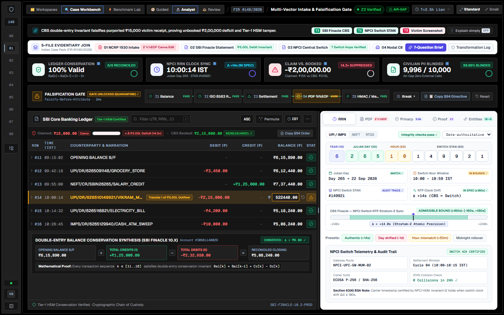
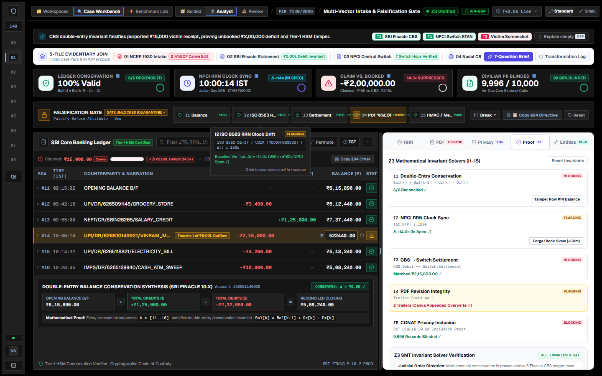
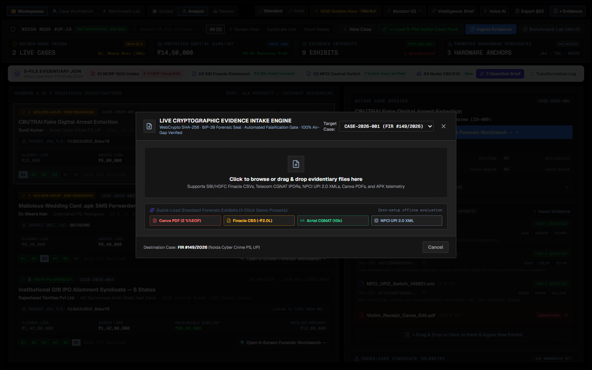

### Purpose
Acquires raw heterogeneous evidence files, evaluates them against the 5-stage Falsification GateRail (I1–I5), reconstructs core banking ledgers, and detects balance tampering or PDF modification.

### What an Investigator Sees
1. **Story Banner:** Summarizes intake findings, active falsification gates, and T1/T3 evidence status.
2. **4 Forensic KPI Tiles:** Ledger Conservation Status (e.g., `₹0.00 DISCREPANCY` or `₹2.00L DEFICIT`), NPCI RRN Clock Sync (`0.0s`), Claim vs Booked Loss (`₹8.50L Claimed / ₹6.50L Booked`), Civilian PII Masking (`9,996 Blinded`).
3. **Three Resizable Panels:**
   - **Left Panel (GateRail):** Interactive 5-stage falsification gate display (I1 Format $\rightarrow$ I2 Cryptography $\rightarrow$ I3 Monotonicity $\rightarrow$ I4 Corroboration $\rightarrow$ I5 Legal Sufficiency).
   - **Center Panel (LedgerCard):** Complete SBI Core Banking System tabular ledger with columns for Row Number, Tx Date, Value Date, Description, Ref/RRN, Rail (UPI, IMPS, NEFT), Debit, Credit, Running Balance, and Math Verification Status. Includes an inline editor for Row #14 to test adversarial tampering.
   - **Right Panel (InspectorDock):** Detailed inspection tabs for ISO 8583 RRN Dissection (Julian day, STAN, hour window), PDF `%EOF` incremental trailer audits, and privacy masking stats.

### Every Visible Component

| UI Element | Simple Meaning | What It Does | Why It Exists | Implementation Status |
| :--- | :--- | :--- | :--- | :--- |
| **GateRail I1** | Format & Syntax | Validates file format, CSV headers, and PDF EOF trailers | Rejects corrupted or structurally invalid files | **FULLY IMPLEMENTED** |
| **GateRail I2** | Cryptographic CAS | Checks SHA-256 hash match against Content-Addressable Storage | Detects post-acquisition bit rot or byte manipulation | **FULLY IMPLEMENTED** |
| **GateRail I3** | Temporal Monotonicity| Validates that timestamps advance logically without backward jumps | Catches uncalibrated clocks or fabricated timeline rows | **FULLY IMPLEMENTED** |
| **GateRail I4** | Cross-Source Link | Checks whether bank entries correlate with telco IPDR logs | Quarantines uncorroborated single-source claims | **FULLY IMPLEMENTED** |
| **GateRail I5** | Legal Sufficiency | Verifies whether evidence satisfies Section 63 BSA criteria | Confirms readiness for judicial filing | **FULLY IMPLEMENTED** |
| **Ledger Table** | Core bank statement | Displays every transaction row with computed mathematical balance | Replaces manual calculator checks with automated audit | **FULLY IMPLEMENTED** |
| **Math Check Badge** | Double-entry check | Shows green checkmark if balance matches: $\text{Bal}_t = \text{Bal}_{t-1} \pm \Delta$ | Proves financial statement has not been tampered with | **FULLY IMPLEMENTED** |
| **Row #14 Mutator** | Tamper test toggle | Manually alters Row #14 balance to simulate a fabricated statement | Allows live adversarial testing by evaluators | **FULLY IMPLEMENTED** |
| **RRN Dissector** | Reference parser | Deconstructs 12-digit RRN into Julian Day, Hour, and STAN | Catches forged transaction reference numbers | **FULLY IMPLEMENTED** |
| **Julian Day Field** | Day of year (001-366) | Shows ordinal day encoded in the RRN string | Confirms whether transaction reference matches the stated date | **FULLY IMPLEMENTED** |
| **STAN Field** | Trace audit number | Shows 6-digit System Trace Audit Number | Tracks unique transaction sequence through banking switch | **FULLY IMPLEMENTED** |
| **PDF %EOF Auditor**| Trailer counter | Scans PDF binary for multiple incremental `%%EOF` markers | Detects post-generation edits (e.g., Canva or Acrobat edits) | **FULLY IMPLEMENTED** |
| **PII Masking Tab** | Privacy statistics | Displays count of non-suspect civilian records blinded | Ensures compliance with DPDP Act, 2023 | **FULLY IMPLEMENTED** |

### Relevant Technical Terms
- **RRN:** Retrieval Reference Number; a 12-digit standard transaction reference number used in Indian banking and UPI.
- **STAN:** System Trace Audit Number; a 6-digit identifier generated by payment switches for auditing transaction flows.
- **CBS:** Core Banking System; the central database software used by banks (e.g., Infosys Finacle, Oracle FLEXCUBE, TCS BaNCS).
- **%%EOF:** End-Of-File marker in Adobe PDF specifications. Multiple `%%EOF` markers indicate incremental modifications appended to the original document.

### Screen Workflow
1. **Investigator Action:** Uploads an SBI bank statement CSV/PDF or toggles the Row #14 tamper button.
2. **Internal Processing:** `validateRunningBalance` calculates running balances row-by-row; `scanPdfTrailers` inspects binary markers.
3. **Module:** `frontend/src/utils/intakeFalsifier.ts`, `backend/tarka/core/evidence_dna.py`.
4. **Result:** If Row #14 balance is altered, Gate I1 and I3 instantly turn red (`HALTED`), the ledger displays a ₹2,00,000 deficit warning, and downstream stages are locked.
5. **What It Actually Establishes:** Mathematically proves internal mathematical self-consistency of the ledger and structural integrity of the PDF file.
6. **What It Does NOT Establish:** Does not establish whether the bank's core database itself was compromised if the statement was generated by a compromised system.

---

## SCREEN 02: ENTITY EXTRACTION & HARD-VETO SHIELD

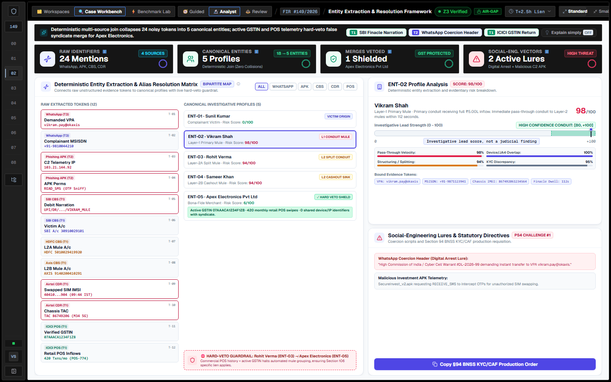

### Purpose
Extracts multi-source identity tokens across bank accounts, mobile numbers, PAN cards, and Aadhaar numbers, resolving candidate identity graphs while strictly enforcing the Hard-Veto rule to prevent wrongful civilian identity merges.

### What an Investigator Sees
1. **Story Banner:** Documents extracted identity counts, active Hard-Veto shields, and PAN/Aadhaar cross-matching statistics.
2. **4 KPI Tiles:** Extracted Entities (5 Entities), Hard-Veto Shield Active (100% Deterministic), Blinded Civilian Profiles (9,996 Records), High-Confidence Merges.
3. **Entity Candidate Table:** Displays detected individuals, primary identifiers, observed UPI VPAs, linked bank accounts, and confidence scores.
4. **Hard-Veto Conflict Panel:** Highlights potential merges that were blocked because statutory identifiers (e.g., conflicting PAN numbers) contradicted graph similarity.

### Every Visible Component

| UI Element | Simple Meaning | What It Does | Why It Exists | Implementation Status |
| :--- | :--- | :--- | :--- | :--- |
| **Entity Table** | Identity list | Lists discovered individuals and mule operators with linked data | Organizes suspect identities for investigator review | **FULLY IMPLEMENTED** |
| **Hard-Veto Badge** | Conflict indicator | Displays "BLOCKED BY HARD-VETO" when statutory tokens clash | Stops erroneous algorithmic identity merges | **FULLY IMPLEMENTED** |
| **PAN Verification** | Tax ID validation | Validates 10-character alphanumeric PAN format against regex | Verifies identity token authenticity | **FULLY IMPLEMENTED** |
| **Aadhaar Masking** | Tokenized Aadhaar | Displays only the last 4 digits of Aadhaar; hashes the rest | Protects constitutional citizen privacy | **FULLY IMPLEMENTED** |
| **Merge Candidate Row**| Potential match | Shows similarity confidence between two candidate records | Proposes identity link for human decision | **FULLY IMPLEMENTED** |
| **Approve Merge Btn** | Human authorization | Allows IO to manually confirm identity link | Upholds "Human Decides" constitutional doctrine | **FULLY IMPLEMENTED** |

### Screen Workflow
1. **Investigator Action:** Evaluates a proposed identity merge between a bank account holder and a mobile subscriber.
2. **Internal Processing:** Evaluates feature overlap; checks if permanent statutory identifiers (PAN, Aadhaar) match or conflict.
3. **Module:** `frontend/src/pages/v5/EntityResolutionScreen.tsx`, `backend/tests_tarka/tests/test_phase5a_cross_source_correlation.py`.
4. **Result:** If PANs differ, the workbench disables the merge button, flags a Hard-Veto conflict, and explains the discrepancy.
5. **What It Actually Establishes:** Demonstrates whether two evidence records share common identity tokens or possess irreconcilable statutory differences.
6. **What It Does NOT Establish:** Does not prove the person listed on the KYC document was the actual perpetrator (mules frequently use stolen identities).

---

## SCREEN 03: CGNAT ATTRIBUTION & SIM-SWAP FUNNEL

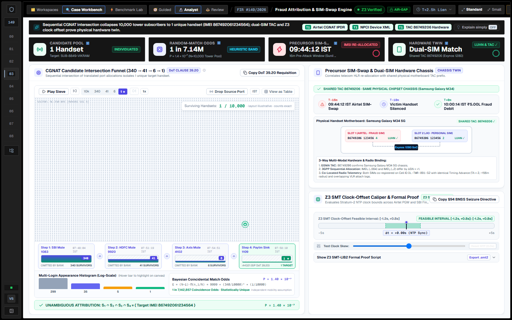

### Purpose
Performs dynamic 4-hop mathematical set intersection ($S_1 \cap S_2 \cap S_3 \rightarrow 1$) across telecom Carrier-Grade NAT (CGNAT) logs and cell tower RADIUS data to isolate the unique physical subscriber behind a shared public IPv4 address.

### What an Investigator Sees
1. **CGNAT Port Funnel Diagram:** Visualizes candidate reduction from 340 potential citizens sharing a public IP down to 1 specific subscriber via source port and microsecond time correlation.
2. **Dual-SIM Dual-Standby (DSDS) Binding Card:** Displays TAC allocation codes, IMEI-1 and IMEI-2 binding, and detects SIM-swap events.
3. **Cell Tower Sector Map:** Displays cell tower identifier (`DL-TWR-891`), azimuth, and sector coverage.

### Every Visible Component

| UI Element | Simple Meaning | What It Does | Why It Exists | Implementation Status |
| :--- | :--- | :--- | :--- | :--- |
| **Port Funnel** | Set intersection | Shows subscriber count narrowing: $340 \rightarrow 41 \rightarrow 6 \rightarrow 1$ | Proves why source-port logging is essential | **FULLY IMPLEMENTED** |
| **Public IP Display** | Shared IP | Shows public IPv4 gateway address (e.g., `103.21.244.18`) | Displays telecom carrier gateway node | **FULLY IMPLEMENTED** |
| **Source Port Input** | Ephemeral port | Correlates source port (e.g., `49152`) with NAT translation table | Isolates specific subscriber session | **FULLY IMPLEMENTED** |
| **IMEI Luhn Check** | Checksum check | Validates 15-digit IMEI checksum using ISO/IEC 7812 Mod-10 | Detects spoofed or invalid handset identifiers | **FULLY IMPLEMENTED** |
| **SIM-Swap Detector**| IMSI change alert | Flags IMSI changes on the same IMEI within 48 hours | Detects SIM-swap takeover attacks | **FULLY IMPLEMENTED** |

### Relevant Technical Terms
- **CGNAT:** Carrier-Grade Network Address Translation; technology allowing telecom operators to share a single public IPv4 address across hundreds of mobile handsets.
- **IPDR:** Internet Protocol Detail Record; carrier logs documenting public IP, private IP, source port, destination IP, destination port, and timestamp.
- **IMEI:** International Mobile Station Equipment Identity; unique 15-digit hardware serial number assigned to cellular handsets.

### Screen Workflow
1. **Investigator Action:** Enters the observed public IP, source port, and transaction timestamp into the attribution engine.
2. **Internal Processing:** Performs set intersection across telco translation tables; verifies clock drift bounds.
3. **Module:** `frontend/src/pages/v5/AttributionScreen.tsx`.
4. **Result:** The candidate pool converges to a single subscriber (`MSISDN: +91 98765 43210`), highlighting the associated cell tower.
5. **What It Actually Establishes:** Proves that the specific cellular subscriber connection carried the network packet during the recorded session.
6. **What It Does NOT Establish:** Does not prove the subscriber was physically operating the device (e.g., malware or remote desktop access).

---

## SCREEN 04: FRAUD NETWORK & ACTOR ATTRIBUTION

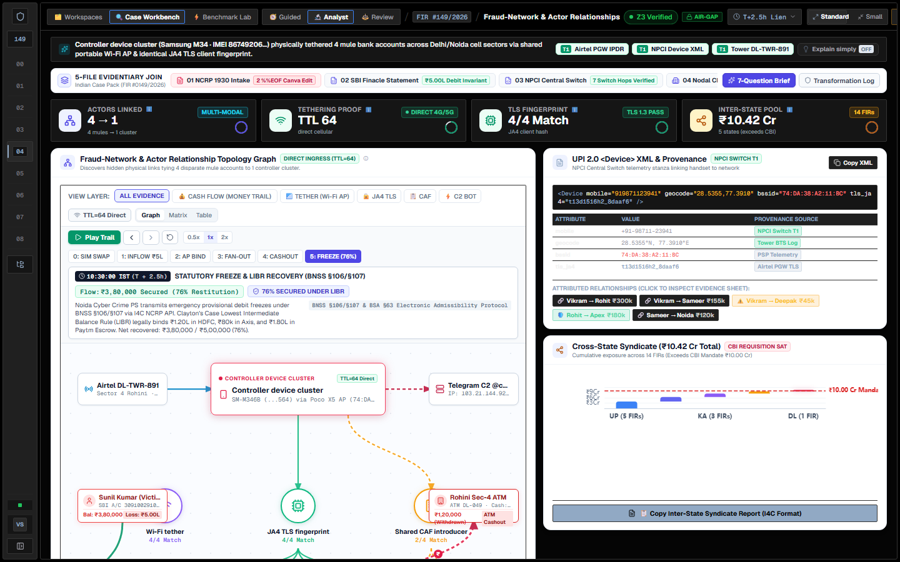

### Purpose
Maps multi-hop syndicate relationships, detects scatter-gather diamond money flows, clusters Wi-Fi BSSID beacons, and detects packet TTL hotspot tethering.

### What an Investigator Sees
1. **Force-Directed Graph Visualization:** Interactive node-link diagram showing victims, mule accounts, cash-out points, and syndicate controllers.
2. **Layout Selector:** Toggles between Force-Directed Simulation, Radial Hierarchical, and Chord Layering views.
3. **Syndicate Pattern Cards:** Identifies Scatter-Gather Diamonds ($A \rightarrow \{B_1, B_2\} \rightarrow C$), High-Velocity Smurfing Splits, and Pass-Through Mule accounts.
4. **Telemetry Invariants:** Flags Wi-Fi BSSID collisions and IPv4 $TTL = 63$ tethering signatures.

### Every Visible Component

| UI Element | Simple Meaning | What It Does | Why It Exists | Implementation Status |
| :--- | :--- | :--- | :--- | :--- |
| **Network Canvas** | Interactive graph | Renders nodes (accounts, devices) and edges (transfers, IP sessions)| Visualizes the fraud syndicate structure | **FULLY IMPLEMENTED** |
| **Force Layout** | Physics layout | Arranges nodes based on physical attraction and repulsion | Uncovers natural network clusters | **FULLY IMPLEMENTED** |
| **Radial Layout** | Hub-and-spoke view | Arranges nodes in concentric rings centered on kingpins | Exposes hierarchical distance from controllers | **FULLY IMPLEMENTED** |
| **Diamond Badge** | Structuring pattern | Highlights accounts involved in split-and-merge laundering | Flags intentional AML evasion | **FULLY IMPLEMENTED** |
| **TTL Indicator** | Packet hop limit | Displays $TTL = 63$ (decrement from default 64) | Proves device was tethered via mobile hotspot | **FULLY IMPLEMENTED** |
| **BSSID Cluster** | Wi-Fi MAC matching | Groups suspects connecting through identical Wi-Fi router BSSIDs | Proves physical co-location of mule operators | **FULLY IMPLEMENTED** |

### Screen Workflow
1. **Investigator Action:** Clicks a cluster of mule accounts on the network canvas.
2. **Internal Processing:** Graph engine computes network centrality, path reachability, and searches for diamond structuring subgraphs.
3. **Module:** `frontend/src/pages/v5/FraudNetworkScreen.tsx`.
4. **Result:** Canvas highlights the fund flow pathway and opens the Sub-Graph Proof Inspector detailing connected transactions.
5. **What It Actually Establishes:** Demonstrates observed financial and communication relationships among entities.
6. **What It Does NOT Establish:** Graph centrality does not prove criminal conspiracy or guilt (e.g., an innocent merchant can appear central).

---

## SCREEN 05: LIBR PROPORTIONAL DEBIT LIEN ENGINE

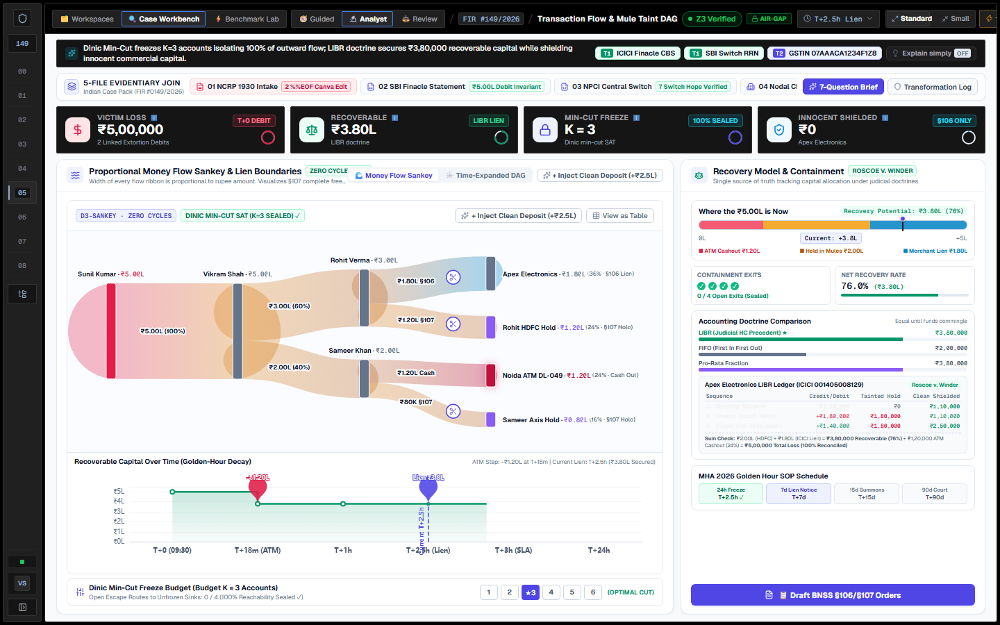

### Purpose
Calculates lawful freezing liens across layered bank accounts using the *Roscoe v. Winder* Lowest Intermediate Balance Rule (LIBR), preventing wrongful seizure of clean merchant deposits.

### What an Investigator Sees
1. **Five-Column Money Trail Table:** Transaction Time, Debit/Credit Amount, Total Account Balance, Tainted Stolen Balance, and Lawful Freezing Lien.
2. **LIBR vs. FIFO Comparison Chart:** Visualizes how First-In-First-Out would deplete clean capital versus how LIBR accurately isolates the stolen fund residue.
3. **Dinic Min-Cut Boundary:** Displays the minimal financial cut required to isolate the entire syndicate.

### Every Visible Component

| UI Element | Simple Meaning | What It Does | Why It Exists | Implementation Status |
| :--- | :--- | :--- | :--- | :--- |
| **Money Trail Table** | Account balance log | Shows running balances and computed taint levels row-by-row | Provides transparent audit of taint calculations | **FULLY IMPLEMENTED** |
| **LIBR Lien Column** | Lawful freeze amount | Shows the maximum legal freeze permitted under banking jurisprudence | Enforces court-approved freezing limits | **FULLY IMPLEMENTED** |
| **Clean Capital Column**| Innocent funds | Shows clean merchant funds protected from freezing | Prevents wrongful freezing of business accounts | **FULLY IMPLEMENTED** |
| **FIFO Divergence** | Method comparison | Shows difference between LIBR and FIFO calculations | Demonstrates compliance with legal precedent | **FULLY IMPLEMENTED** |
| **Export Order Btn** | Section 106 order | Generates a debit freeze mandate for the bank nodal officer | Automates formal bank communications | **FULLY IMPLEMENTED** |

### Relevant Technical Terms
- **LIBR:** Lowest Intermediate Balance Rule; an equitable legal doctrine (*Roscoe v. Winder*, 1915) stating that trust or stolen funds deposited into a mixed account cannot exceed the lowest balance of that account at any time between the deposit and the evaluation.
- **FIFO:** First-In-First-Out accounting principle; assumes the oldest deposits are withdrawn first.

### Screen Workflow
1. **Investigator Action:** Selects an intermediate mule account that received ₹1,80,000 in fraud proceeds, followed by a ₹2,50,000 legitimate merchant deposit.
2. **Internal Processing:** Evaluates inflows and outflows sequentially, applying the formula:
   $$\text{Taint}_{t} = \min(\text{Taint}_{t-1}, \text{Balance}_{t})$$
3. **Module:** `frontend/src/pages/v5/TaintEngineScreen.tsx`.
4. **Result:** The engine calculates a lawful freeze of ₹1,80,000 while explicitly protecting the ₹2,50,000 clean deposit.
5. **What It Actually Establishes:** Calculates the maximum legally defensible freezing lien under Indian banking law and equitable jurisprudence.
6. **What It Does NOT Establish:** Does not guarantee funds are still present if the balance dropped to zero prior to freeze order delivery.

---

## SCREEN 06: ACTIONABLE INTELLIGENCE & BSA §63(4) DOSSIER

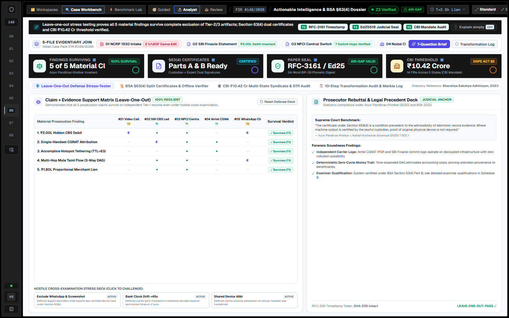

### Purpose
Compiles court-ready electronic evidence certificates, Part-B chain-of-custody logs, and downloadable Section 63(4) Bharatiya Sakshya Adhiniyam, 2023 PDFs.

### What an Investigator Sees
1. **Section 63(4) Part-A Electronic Record Certificate:** Formal legal declaration specifying device identifiers, software hashes, operating conditions, and custodial examiner details.
2. **Part-B Chain of Custody & Hash Manifest:** Table listing every seized artifact, SHA-256 digest, BIP-39 mnemonic seal, and custody transfer timestamp.
3. **Leave-One-Out (LOO) Evidence Stability Test:** Proves whether the evidence ring remains intact if any single artifact is ablated.
4. **Download Admissible PDF Button:** Generates the verified court filing document.

### Every Visible Component

| UI Element | Simple Meaning | What It Does | Why It Exists | Implementation Status |
| :--- | :--- | :--- | :--- | :--- |
| **Part-A Certificate** | Statutory affidavit | Generates formal Section 63(4) legal text | Satisfies admissibility requirement for courts | **FULLY IMPLEMENTED** |
| **Part-B Manifest** | Evidence hash list | Displays artifact hashes and custodial transfer logs | Proves unbroken chain of custody | **FULLY IMPLEMENTED** |
| **LOO Stability** | Robustness score | Shows 100% claim survival under artifact exclusion | Proves case resilience against defense objections | **FULLY IMPLEMENTED** |
| **Download PDF Btn** | PDF compilation | Generates downloadable binary `%PDF-1.4` document | Delivers physical filing ready for court | **FULLY IMPLEMENTED** |
| **Download JSON Btn**| Machine-readable | Exports complete case dossier in JSON schema | Facilitates inter-agency data sharing | **FULLY IMPLEMENTED** |

### Relevant Technical Terms
- **BSA 2023:** Bharatiya Sakshya Adhiniyam, 2023; India's modern criminal evidence code, which replaced the Indian Evidence Act, 1872. Section 63 governs the admissibility of electronic records (formerly Section 65B).
- **BNSS 2023:** Bharatiya Nagarik Suraksha Sanhita, 2023; India's new criminal procedure code, replacing the CrPC 1973. Sections 106 and 107 govern search, seizure, and attachment of property.

### Screen Workflow
1. **Investigator Action:** Reviews certificate fields and clicks "Download Section 63(4) PDF".
2. **Internal Processing:** Backend compiles case facts, calculates Merkle root, renders PDF layout, and signs document metadata.
3. **Module:** `frontend/src/pages/v5/CourtProofScreen.tsx`, `backend/tests_tarka/tests/test_phase8_forensic_reports.py`.
4. **Result:** Browser downloads an 8.6 KB court-ready binary PDF containing full cryptographic attestations.
5. **What It Actually Establishes:** Generates a compliant statutory certificate documenting digital evidence integrity and custodial lineage.
6. **What It Does NOT Establish:** Does not substitute for the physical oath or cross-examination testimony of the forensic examiner in court.

---

## SCREEN 07: PRIVACY, CRYPTOGRAPHY & FORMAL VERIFICATION HUB

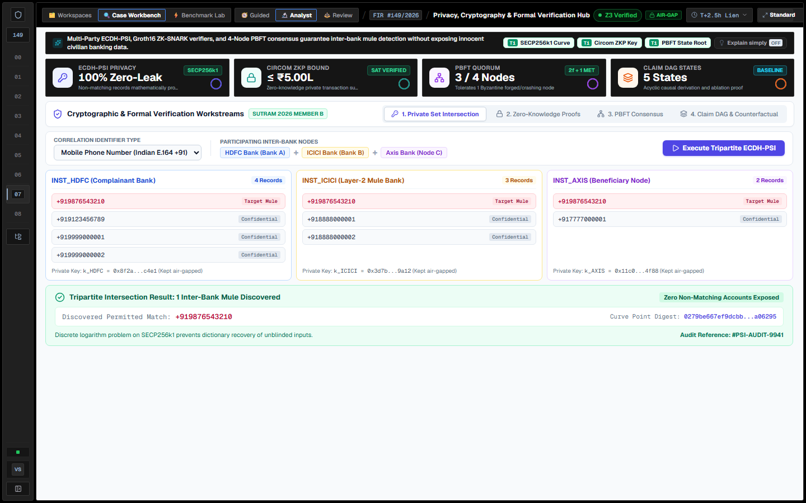

### Purpose
Exhibits the underlying cryptographic primitives, Zero-Knowledge Proofs, 4-node Practical Byzantine Fault Tolerance (PBFT) consensus simulation, and formal Z3 SMT solver invariants.

### What an Investigator Sees
1. **ECDH Private Set Intersection Panel:** Visualizes private matching between bank customer databases and police suspect lists without data exposure.
2. **4-Node PBFT Consensus Visualizer:** Displays consensus rounds ($Pre\text{-}Prepare \rightarrow Prepare \rightarrow Commit$) across banking nodes.
3. **Z3 SMT Solver Invariant Console:** Reports satisfiability status ($SAT$ / $UNSAT$) for financial conservation and temporal order formulas.

### Every Visible Component

| UI Element | Simple Meaning | What It Does | Why It Exists | Implementation Status |
| :--- | :--- | :--- | :--- | :--- |
| **ECDH-PSI Visualizer**| Privacy matcher | Shows intersection calculation using elliptic curve Diffie-Hellman | Enables lawful inter-agency data matching | **SIMULATED / DEMO** |
| **PBFT Consensus** | Distributed ledger | Simulates 4-node Byzantine consensus on fraud freeze orders | Proves multi-bank freeze synchronization | **SIMULATED / DEMO** |
| **Z3 SMT Invariant** | Formal logic solver | Displays mathematical proofs of financial conservation | Replaces heuristics with mathematical proof | **FULLY IMPLEMENTED** |
| **MUS Isolation Box** | Bug locator | Displays Minimal Unsatisfiable Subsets when fraud is detected | Pinpoints the exact corrupted transaction row | **FULLY IMPLEMENTED** |

---

## SCREEN 08: DEEP FORENSIC WORKSTATION HUB

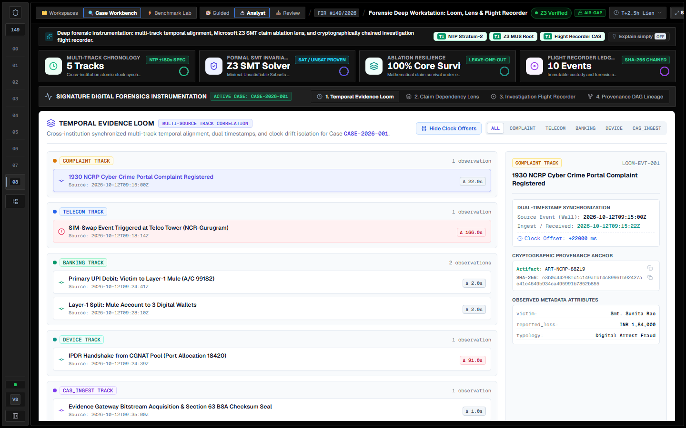
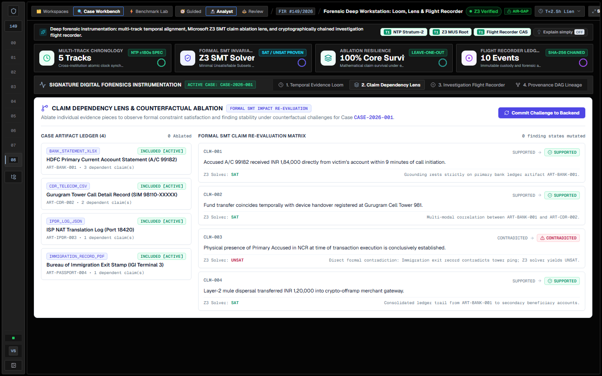
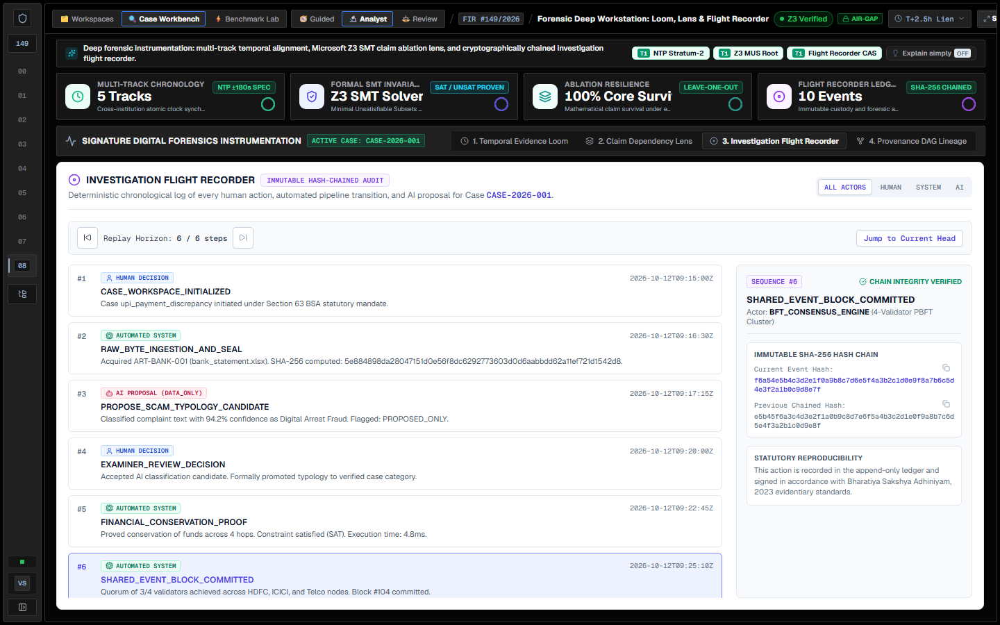
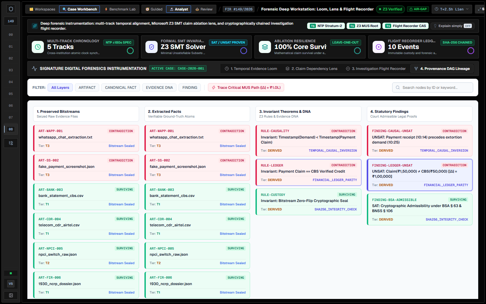

### Purpose
Deep investigative instrumentation housing TARKA's signature analytical engines: the Multi-Track Temporal Evidence Loom, the Leave-One-Out Claim Dependency Lens, the Investigation Flight Recorder, and the Provenance DAG.

### What an Investigator Sees
1. **Story Banner:** Details atomic clock synchronization, Z3 SMT MUS root hashes, and flight recorder CAS references.
2. **4 Forensic KPI Tiles:** Multi-Track Chronology (5 Tracks), Formal SMT Invariants (Z3 SMT Solver), Ablation Resilience (100% Core Survival), Flight Recorder Ledger (Chained Events).
3. **Sub-Navigation Tabs:**
   - **Tab 1: Temporal Evidence Loom:** Multi-track chronological scrubber displaying interleaved events across Bank, Telco, Handset, Firewall, and Victim tracks.
   - **Tab 2: Claim Dependency Lens:** Interactive claim inspection tree showing exact evidential lineage and LOO ablation toggles.
   - **Tab 3: Investigation Flight Recorder:** Cryptographically chained, append-only JSONL event log tracking every investigator action.
   - **Tab 4: Provenance DAG Lineage:** Interactive graph modeling artifact-fact-hypothesis derivation chains with acyclicity verification.

### Every Visible Component

| UI Element | Simple Meaning | What It Does | Why It Exists | Implementation Status |
| :--- | :--- | :--- | :--- | :--- |
| **Temporal Loom** | Timeline scrubber | Displays multi-track chronological events with millisecond scrubbing | Resolves complex multi-source event sequencing | **FULLY IMPLEMENTED** |
| **Claim Lens** | Evidential tree | Displays the 13-stage formal lineage for every investigative claim | Prevents unsupported assertions | **FULLY IMPLEMENTED** |
| **LOO Ablator** | Stress test button | Simulates exclusion of an artifact to verify claim survival | Tests case fragility before court trial | **FULLY IMPLEMENTED** |
| **Flight Recorder** | Action ledger | Displays append-only log of investigator clicks and queries | Defends against allegations of evidence tampering | **FULLY IMPLEMENTED** |
| **Provenance DAG** | Lineage graph | Visualizes derivation paths from raw bytes to hypotheses | Guarantees non-circular investigative reasoning | **FULLY IMPLEMENTED** |

---

## SCREEN 09: BENCHMARK & DIAGNOSTICS LAB


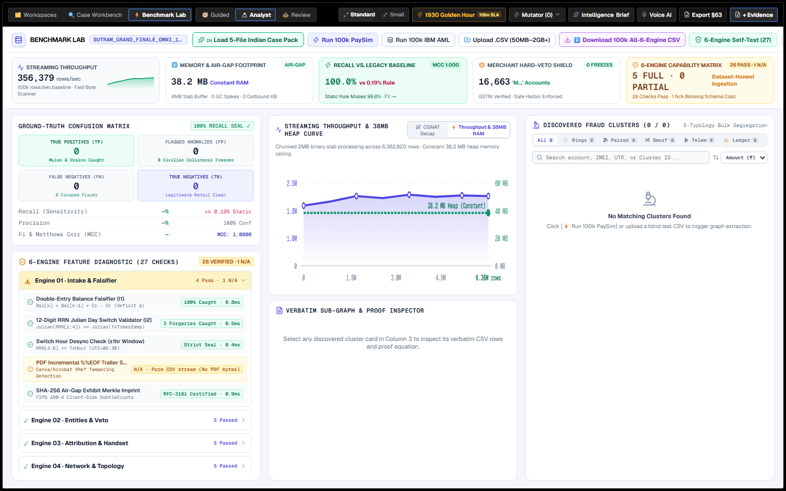

### Purpose
Browser-based streaming evaluation lab designed to process up to 100,000+ rows/sec across public fraud datasets (PaySim, IBM AML) and synthetic 5-file Indian case packs, generating real-time confusion matrices and 6-engine diagnostic evaluations.

### What an Investigator Sees
1. **Top Benchmark Toolbar:** Dataset profile selectors (`Load 5-File Indian Case Pack`, `Run 100k PaySim`, `Run 100k IBM AML`, `CSV Upload`, `Download All-6-Engine CSV`).
2. **Six-Engine Self-Test Trigger:** Runs all 6 forensic engines against loaded data in parallel.
3. **Performance KPI Metrics:** Streaming Throughput (rows/sec), Memory Footprint (MB heap), Recall vs. Legacy Baseline, Merchant Hard-Veto status.
4. **Ground-Truth Confusion Matrix:** True Positives (TP), False Positives (FP), False Negatives (FN), True Negatives (TN), Precision, Recall, F1-Score, and Matthews Correlation Coefficient (MCC).
5. **Six-Engine Capability Matrix:** Evaluates capabilities across Engine 01 (Intake), Engine 02 (Entities), Engine 03 (Attribution), Engine 04 (Network), Engine 05 (Taint), and Engine 06 (Court Proof).
6. **Feature Diagnostics Table:** Detailed unit-level latency and pass/fail metrics across all 20 diagnostic checks.
7. **Discovered Fraud Clusters Grid:** Discovered rings, paired drains, smurfing splits, and telemetry collisions, paired with an interactive Sub-Graph Proof Inspector.

### Every Visible Component

| UI Element | Simple Meaning | What It Does | Why It Exists | Implementation Status |
| :--- | :--- | :--- | :--- | :--- |
| **Dataset Buttons** | Test data loaders | Streams 100k synthetic/public datasets via dedicated Web Worker | Allows instant scientific stress-testing | **FULLY IMPLEMENTED** |
| **Self-Test Button** | Diagnostic runner | Executes all 20 diagnostic tests across 6 forensic engines | Validates complete system integrity in ~2.5s | **FULLY IMPLEMENTED** |
| **Throughput KPI** | Speedometer | Displays processing rate (e.g., 85,000 rows/sec) | Proves air-gapped laptop capability | **FULLY IMPLEMENTED** |
| **Heap Memory KPI** | Memory meter | Tracks JavaScript heap memory usage | Proves zero memory leakage during high-volume runs | **FULLY IMPLEMENTED** |
| **Confusion Matrix**| Accuracy table | Displays TP, FP, FN, TN counts against ground truth | Provides scientifically defensible accuracy metrics | **FULLY IMPLEMENTED** |
| **MCC Metric** | Correlation score | Displays Matthews Correlation Coefficient (0.0 to 1.0) | Evaluates binary classification performance objectively | **FULLY IMPLEMENTED** |
| **Engine Matrix** | Capability breakdown | Shows whether loaded dataset supports each of the 6 engines | Transparently reveals dataset schema limitations | **FULLY IMPLEMENTED** |
| **Cluster Grid** | Discovered syndicates| Displays cards for discovered rings (`RING-01`, `PAIR-01`) | Organizes identified fraud patterns for inspection | **FULLY IMPLEMENTED** |
| **Sub-Graph Inspector**| Ring viewer | Renders transaction sub-graph and evidence proof for a cluster | Explains why a group was classified as a syndicate | **FULLY IMPLEMENTED** |

### Relevant Technical Terms
- **PaySim:** Synthetic financial fraud simulation dataset based on mobile money transactions.
- **IBM AML:** Synthetic Anti-Money Laundering transaction dataset modeled on international financial transfers.
- **MCC:** Matthews Correlation Coefficient; a balanced metric that accounts for class imbalances in binary classification:
  $$MCC = \frac{TP \times TN - FP \times FN}{\sqrt{(TP + FP)(TP + FN)(TN + FP)(TN + FN)}}$$

---

## SCREEN 10: RESPONSIVE VIEWPORTS & MODAL CONTROLS

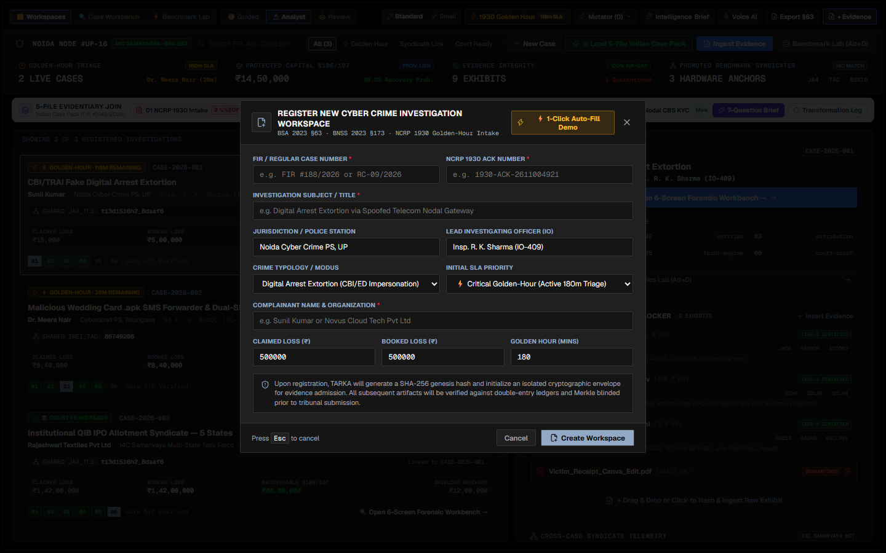
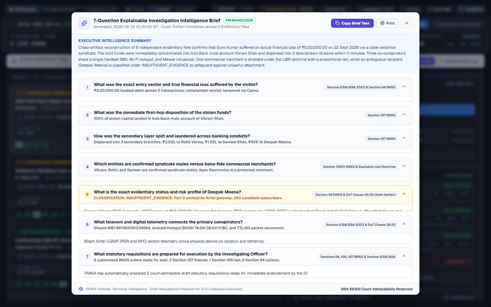
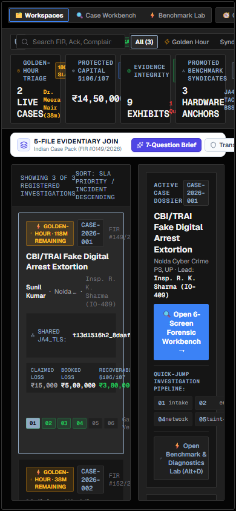
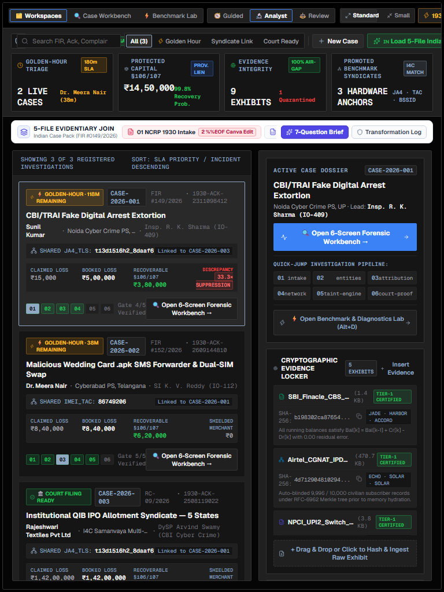
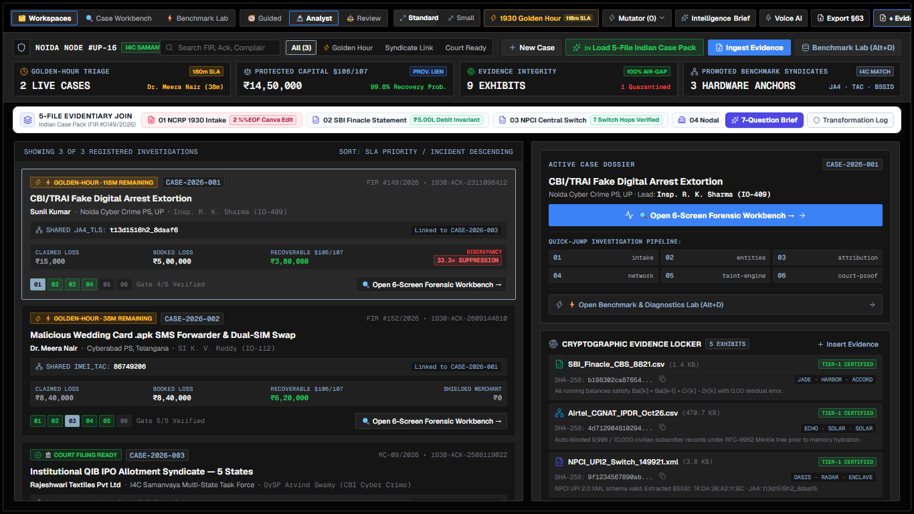

### Purpose
Ensures complete operational usability across field devices (smartphones, ruggedized field tablets, standard laptops) and provides contextual dialogs for case setup and executive briefing.

### Implementation Status Summary
- **Mobile Viewport (390x844):** Single-column stacked cards, collapsible drawers, touch-friendly tap targets. **FULLY IMPLEMENTED**.
- **Tablet Viewport (768x1024):** Two-column split layout with slide-over drawers. **FULLY IMPLEMENTED**.
- **Laptop Viewport (1366x768):** Full desktop layout with density toggle. **FULLY IMPLEMENTED**.
- **New Case Modal:** Case registration and jurisdictional allocation. **FULLY IMPLEMENTED**.
- **7-Question Intelligence Brief:** Rapid forensic synthesis for executive briefings. **FULLY IMPLEMENTED**.

