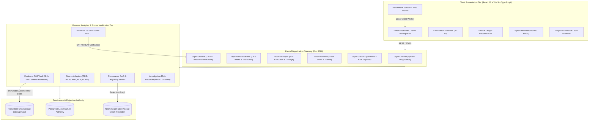
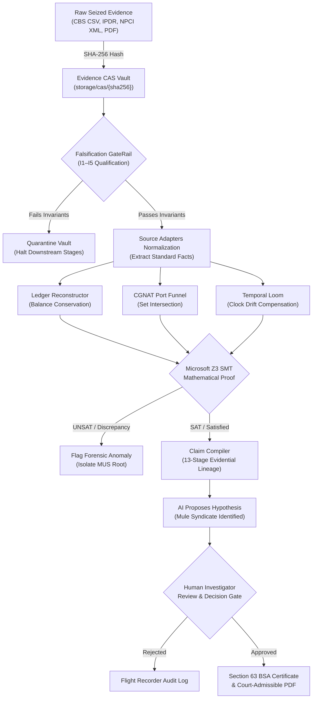

# TARKA: TECHNICAL ARCHITECTURE & SYSTEMS ENGINEERING SPECIFICATION
**Detailed Subsystem Architecture, Component Boundaries, Data Models & Forensic Invariants**  
**Repository Working Directory:** `C:\PROJECTS\tarka_v5_clean_verify`  
**Governing Doctrine:** AI PROPOSES. EVIDENCE VERIFIES. HUMAN DECIDES.  
**Auditor Roles:** Principal Systems Architect & Senior DevSecOps Engineer  

---

## 1. HIGH-LEVEL SYSTEM ARCHITECTURE

TARKA is engineered as a decoupled, multi-tier forensic intelligence workbench optimized for air-gapped forensic laboratories, high-throughput batch processing, and low-latency interactive investigation.

---

## 2. REPOSITORY MODULE DIRECTORY & FILE REFERENCE

The table below maps core forensic capabilities to their exact repository source files:

| Subsystem Component | Primary File Path | Implementation Role |
| :--- | :--- | :--- |
| **Global Shell & State** | `frontend/src/components/shell/TarkaGlobalShell.tsx` `frontend/src/context/TarkaGlobalContext.tsx` | Top-level routing, keyboard shortcuts, mutation toggles, and multi-case workspace state. |
| **Intake Falsifier & Ledger** | `frontend/src/utils/intakeFalsifier.ts` `frontend/src/components/tarka/intake/LedgerCard.tsx` | Double-entry balance checking, RRN Julian day dissection, PDF incremental trailer scanning. |
| **GateRail Pipeline** | `frontend/src/components/tarka/intake/GateRail.tsx` | Visual progressive validation pipeline enforcing Gates I1 through I5. |
| **Forensic Cryptography** | `frontend/src/utils/forensicCrypto.ts` | SHA-256 hashing, BIP-39 mnemonic seals, PGP biometric phonetic word lists, Merkle tree roots. |
| **Network Physics & Layout** | `frontend/src/pages/v5/FraudNetworkScreen.tsx` `frontend/src/components/tarka/network/ForceSimulationEngine.ts` | Force-directed simulations, radial hierarchy layouts, and syndicate pattern detection. |
| **LIBR Taint Calculations** | `frontend/src/pages/v5/TaintEngineScreen.tsx` `frontend/src/utils/taintCalculators.ts` | *Roscoe v. Winder* lowest intermediate balance calculation, FIFO comparison, and Dinic min-cut. |
| **Streaming Benchmark Worker**| `frontend/src/workers/publicDatasetStreamer.worker.ts` `frontend/src/pages/v5/BenchmarkLabScreen.tsx` | High-speed multi-threaded dataset streaming, confusion matrix calculations, and diagnostics. |
| **Backend API Gateway** | `backend/app/main.py` | FastAPI application bootstrap, CORS middleware, exception handlers, and 164 OpenAPI route registrations. |
| **Evidence DNA & CAS** | `backend/tarka/core/evidence_dna.py` | SHA-256 CAS storage, MIME detection, defensive sanitization, and case workspace allocation. |
| **Source Adapters Registry** | `backend/tarka/adapters/source_adapters.py` | Heterogeneous record parsers (Finacle CBS CSV, Airtel IPDR, NPCI XML, Cellebrite mobile). |
| **Formal Verification Engine** | `backend/tests/test_ps04_formal_verification.py` `backend/tarka/core/formal_verification.py` | Microsoft Z3 SMT solver integration proving financial conservation and temporal monotonic order. |
| **Timeline Reconstruction** | `backend/tarka/core/timeline_reconstruction.py` | Cross-source event normalization, clock drift offset compensation, and multi-track chronological indexing. |
| **Provenance DAG Engine** | `backend/tests_tarka/tests/test_phase4a_dag_and_rules.py` `frontend/src/components/graphs/ProvenanceDAGView.tsx` | Acyclic graph modeling of facts, observations, and hypotheses with topological validation. |
| **Statutory BSA Report Gen**| `backend/tests_tarka/tests/test_phase8_forensic_reports.py` `frontend/src/pages/v5/CourtProofScreen.tsx` | Section 63(4) BSA 2023 certificate generator, hash preservation manifests, and binary PDF creation. |

---

## 3. EVIDENCE DATA FLOW & REASONING PIPELINE

Every piece of evidence processed by TARKA moves through a strictly validated pipeline:

---

## 4. SUBSYSTEM IMPLEMENTATION DETAILS

### 4.1 Content-Addressable Storage (CAS)
- **Authority:** `backend/tarka/core/evidence_dna.py`.
- **Mechanism:** Files are written to disk at `storage/cas/{sha256}`. Before writing, the byte stream is hashed using SHA-256. If a file with the identical hash already exists, the upload is recognized as an idempotent duplicate and the existing artifact ID is returned without duplicate storage.
- **Tamper Resistance:** Any single-bit change yields an entirely distinct hash; original files cannot be overwritten.

### 4.2 Mathematical Formal Verification (Z3 SMT Solver)
- **Authority:** `z3-solver` v5.1.0 in Python backend.
- **Theory:** Quantifier-free linear integer and real arithmetic ($QF\_LIRA$).
- **Invariants Checked:**
  1. **Ledger Balance Conservation:**
     $$\forall i \in [1, N]:\quad \text{Bal}_i = \text{Bal}_{i-1} + \text{Credit}_i - \text{Debit}_i$$
  2. **Inter-Account Conservation:**
     $$\sum_{m \in Mules} \text{Credit}_m \le \text{Debit}_{Victim}$$
  3. **Temporal Causality Monotonicity:**
     $$T_{Victim\_Debit} \le T_{Switch\_Transit} \le T_{Mule\_Credit} \le T_{Cash\_Out}$$
- **Outcome:** Returns `sat` (with certified zero discrepancy) or `unsat` (extracting the Minimal Unsatisfiable Subset to isolate the fraudulent transaction row).

### 4.3 Graceful Degradation & Network Isolation
- **Air-Gap Capability:** TARKA operates 100% offline without external internet connectivity.
- **Database Fallbacks:**
  - If Neo4j (port 7687) is unreachable, graph algorithms run via high-performance in-memory and SQLite-backed projection tables.
  - If external MinIO/S3 object stores are absent, the CAS engine automatically routes blobs to the local filesystem.
  - If cloud Voice AI APIs are absent, the system routes requests to a deterministic local forensic audio mock provider.

