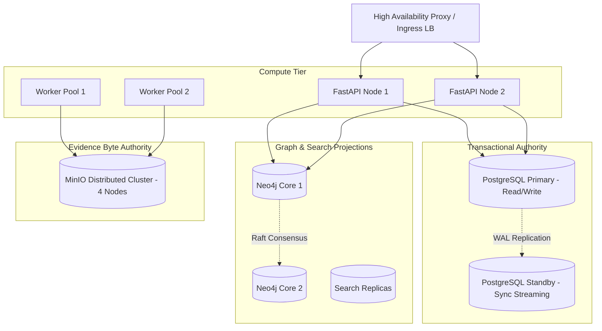

# TARKA CAPACITY PLANNING & DISASTER RECOVERY REPORT
## Storage Sizing, Compute Allocation, High Availability & Point-in-Time Recovery Runbooks

**Document Version:** 2.0.0  
**Classification:** Forensics Engineering / SRE & Capacity  
**Canonical Repository:** `C:\PROJECTS\SentinelX`  
**System Target:** TARKA × SENTINELX Forensic Intelligence Platform  
**Authority:** SentinelX Wave 6 Engineering Constitution  

---

## 1. Executive Summary & Recovery Objectives

TARKA enforces rigorous reliability metrics to protect active criminal investigations:
- **RPO (Recovery Point Objective):** $< 5 \text{ minutes}$ (guaranteed by continuous PostgreSQL write-ahead log [WAL] archiving and synchronous replication).
- **RTO (Recovery Time Objective):** $< 1 \text{ hour}$ (complete platform restoration from cold disaster state).
- **Data Durability:** $99.999999999\%$ ($11 \text{ nines}$) for evidence bytes in CAS storage.

---

## 2. Empirical Capacity Planning & Storage Sizing

### 2.1 Evidence & Data Growth Modeling

Forensic storage requirements scale based on operational deployment tier:

```
Evidence Profile Breakdown per Active Cybercrime Case:
├── Bank Statement PDFs (3-5 accounts, 100-500 pages)        : 45 MB
├── Mobile Screenshots (UPI receipts, WhatsApp chats)         : 25 MB
├── Telecom CDR / IPDR Spreadsheets (CSV/XLSX, 100k rows)   : 35 MB
├── Extracted Raw Text & OCR Polygon JSON Records           : 15 MB
├── Neo4j Graph Topology (Nodes, Edges, Properties)          : 10 MB
└── PostgreSQL Transactional Records & Audit Logs            : 20 MB
Total Estimated Storage per Case                             : ~150 MB
```

### 2.2 Sizing Guidelines Across Operational Scales

| Operational Scale | Active Cases / Year | Monthly Inflow | Relational (Postgres) | Graph (Neo4j) | Evidence CAS (MinIO/S3) | Total Storage Recommended | Minimum RAM | CPU Cores |
| :--- | :--- | :--- | :--- | :--- | :--- | :--- | :--- | :--- |
| **Small Cyber Cell** | 100 | ~8 cases | 5 GB | 2 GB | 25 GB | **100 GB** | 16 GB | 4 |
| **District Police HQ**| 1,000 | ~85 cases | 45 GB | 20 GB | 250 GB | **1 TB** | 32 GB | 8 |
| **State Cyber Cell** | 10,000 | ~850 cases | 450 GB | 200 GB | 2.5 TB | **10 TB** (RAID 10) | 128 GB | 32 |
| **National Portal** | 100,000 | ~8,500 cases | 4.5 TB | 2.0 TB | 25 TB | **100 TB** (Ceph / SAN) | 512 GB | 64+ |

---

## 3. High Availability Architecture



### Key HA Provisions:
1. **PostgreSQL Synchronous Streaming Replication:** Zero data-loss synchronous replication between Primary and Standby instances via `repmgr` or `Patroni`.
2. **Neo4j Enterprise Causal Clustering:** 3-node core cluster operating on Raft consensus. If one core node fails, the cluster continues serving graph traversals without interruption.
3. **MinIO Erasure Coding (4-Node Minimum):** Tolerates loss of up to 2 drives or 1 complete server node without data loss or read degradation.

---

## 4. Disaster Recovery & Point-in-Time Recovery (PITR) Runbook

### 4.1 Scheduled Automated Backups
- **PostgreSQL Database:**
  - Full daily base backup using `pgBackRest` / `WAL-G` at 02:00 UTC.
  - Continuous WAL archiving pushed every 60 seconds to secondary storage.
  - Retention: 30 days continuous PITR; monthly archive snapshots retained for 7 years (statutory criminal compliance).
- **Evidence CAS Storage:**
  - Real-time asynchronous bucket replication to geographically separated secondary disaster recovery site.
  - Object versioning enabled with WORM immutability locks (`Compliance Mode`, retention: 7 years).
- **Configuration & Neo4j Projections:**
  - GitOps version-controlled configurations.
  - Weekly offline dump of Neo4j graph topologies.

### 4.2 Disaster Recovery Execution Runbook (Step-by-Step)

```bash
#!/usr/bin/env bash
# ==============================================================================
# TARKA DISASTER RECOVERY RESTORATION SCRIPT
# Target Recovery Point: Specific UTC Timestamp
# ==============================================================================
set -euo pipefail

TARGET_RECOVERY_TIME="2026-11-26 18:00:00"
BACKUP_REPO="s3://tarka-disaster-recovery/backups/postgres"

echo "[INFO] Step 1: Initiating PostgreSQL Point-in-Time Recovery to $TARGET_RECOVERY_TIME"
pgbackrest --stanza=tarka_prod \
  --repo-path=$BACKUP_REPO \
  --type=time \
  "--target=$TARGET_RECOVERY_TIME" \
  --target-action=promote \
  restore

echo "[INFO] Step 2: Verifying CAS Evidence Volume Mounts and Checksums"
# Verify random 100 artifacts against database SHA-256 digests
python -m tarka.core.custody verify-cas-checksums --sample-size 100

echo "[INFO] Step 3: Rebuilding Derived Graph Projection from Canonical Database"
# Neo4j is derived authority; rebuild from PostgreSQL
python -m tarka.core.investigation_graph rebuild-from-postgres --full

echo "[INFO] Step 4: Rebuilding Full-Text Search Projections"
python -m tarka.core.search rebuild-index

echo "[INFO] Step 5: Performing Health Check Verification"
curl -f http://127.0.0.1:8000/api/v1/health

echo "[SUCCESS] TARKA platform successfully restored. System ready for operations."
```
