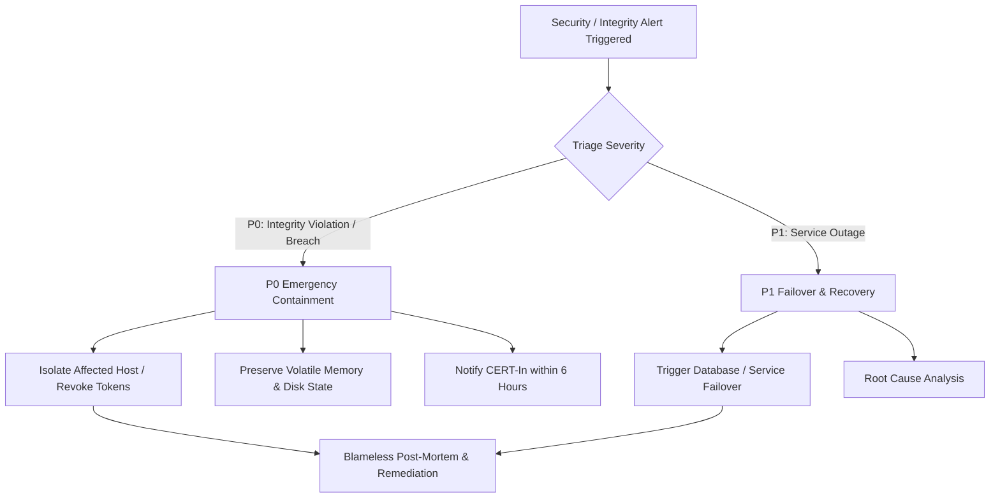

# TARKA INCIDENT RESPONSE RUNBOOK
## Security Incident Classification, Containment Protocols, Forensic Preservation & Regulatory Escalation

**Document Version:** 2.0.0  
**Classification:** Forensics Engineering / SRE & Security Operations  
**Canonical Repository:** `C:\PROJECTS\SentinelX`  
**System Target:** TARKA × SENTINELX Forensic Intelligence Platform  
**Authority:** SentinelX Wave 6 Engineering Constitution  

---

## 1. Incident Severity Classification & Escalation Matrix

TARKA classifies operational and security incidents into four severity levels with strict Service Level Agreements (SLAs).

| Severity Level | Definition | Examples | Response SLA | Target Resolution | Mandatory Escalation |
| :--- | :--- | :--- | :--- | :--- | :--- |
| **P0 — CRITICAL** | Catastrophic security breach, evidence loss, active exfiltration, or total platform outage | SHA-256 evidence mismatch; unauthorized root access; DB corruption; freeze order failure | **Immediate (< 15m)** | $< 2$ hours | CISO, Lead Agency IO, CERT-In (< 6h) |
| **P1 — HIGH** | Core feature impaired, credential compromise, high-volume ingestion failure | OCR engine crash across worker pool; compromised IO account; Neo4j cluster degraded | **< 30 minutes** | $< 6$ hours | Lead System Architect, Agency Duty Officer |
| **P2 — MEDIUM** | Non-critical component degraded, intermittent latency, single connector failure | Telecom SFTP feed down; background report generation delayed; search index drift | **< 2 hours** | $< 24$ hours | Engineering On-Call Lead |
| **P3 — LOW** | Minor cosmetic defect, non-blocking bug, documentation inconsistency | UI typography alignment; minor export styling issue; non-urgent alert false-positive | **< 1 business day** | Next sprint | Development Team |

---

## 2. Emergency Incident Response Workflows



---

## 3. Playbook 1: Cryptographic Evidence Tampering or Hash Mismatch (P0)

### Symptoms:
- Automated custody check triggers `ERR_CUSTODY_HASH_MISMATCH`.
- Raw byte digest computed during read does not equal the SHA-256 recorded in the Provenance DAG.

### Emergency Response Procedure:
1. **Immediate Quarantine:**
   - Execute instant case lockdown to prevent compromised evidence from being presented in court:
     ```bash
     python -m tarka.core.custody lockdown-case --case-id CASE-XXXX --reason "EVIDENCE_HASH_MISMATCH"
     ```
   - All derived graph entities and statutory certificates for the affected case are marked `TAMPER_ALERT_SUSPENDED`.
2. **Volatile Evidence Preservation:**
   - Take snapshot of storage volume and host memory for forensic investigation:
     ```bash
     dd if=/dev/nvme0n1p3 of=/evidence_vault/tamper_forensic_image.dd bs=4M conv=noerror,sync
     ```
3. **Verify WORM Storage & Secondary Replica:**
   - Compare compromised file with write-once read-many (WORM) secondary storage replica.
   - If secondary replica matches original Genesis Hash, restore file and audit access logs for the affected primary block.
4. **Initiate Internal Security Audit:**
   - Trace all user access, process IDs, and disk modifications affecting the storage block within the last 72 hours.

---

## 4. Playbook 2: Compromised Investigating Officer Account (P0 / P1)

### Symptoms:
- Multiple concurrent logins from disparate IP addresses or abnormal foreign geographic locations.
- Attempted bulk export of high-profile political or corporate fraud dossiers.

### Emergency Response Procedure:
1. **Instant Session Invalidation & Token Revocation:**
   ```bash
   # Revoke all active JWT tokens for user across Redis session store
   curl -X POST http://127.0.0.1:8000/api/v1/auth/revoke-user-sessions \
     -H "Authorization: Bearer $SYSTEM_ADMIN_TOKEN" \
     -d '{"user_id": "OFFICER_1042", "reason": "SUSPECTED_CREDENTIAL_COMPROMISE"}'
   ```
2. **Account Suspension & Credential Lockout:**
   - Set `user.is_active = FALSE` in PostgreSQL database.
   - Lock linked enterprise LDAP / Active Directory credentials.
3. **Access Audit Trail Reconstruction:**
   - Extract exhaustive query history of the compromised account for the preceding 14 days:
     ```bash
     python -m tarka.core.audit extract-user-trail --user-id OFFICER_1042 --days 14 --out audit_trail.json
     ```
4. **Statutory Incident Notification:**
   - If unauthorized case access or data exfiltration occurred, assemble CERT-In Form 1 and notify Indian CERT within 6 hours as mandated by CERT-In Directions.

---

## 5. Playbook 3: Ingestion Worker Exhaustion / Queue Overflow (P1)

### Symptoms:
- Ingestion queue depth exceeds 500 unprocessed evidence jobs.
- API response times degrade; worker CPU reaches 100%.

### Emergency Response Procedure:
1. **Engage Ingress Traffic Shedding:**
   - Throttle non-critical batch uploads (historical bank feeds) to preserve bandwidth for Golden-Hour active loss freeze requests.
2. **Scale Horizontal Worker Pods:**
   ```bash
   kubectl scale deployment/tarka-ocr-worker -n tarka --replicas=12
   kubectl scale deployment/tarka-ingestion-worker -n tarka --replicas=8
   ```
3. **Verify Worker Health:**
   - Check worker logs for hanging processes on corrupt PDF files:
     ```bash
     kubectl logs -n tarka -l app=tarka-ocr-worker --tail=100 | grep "ERR_"
     ```
   - Workers stuck for $> 300\text{s}$ are automatically terminated by Kubernetes liveness probes and the offending job is rerouted to the Dead-Letter Queue.
