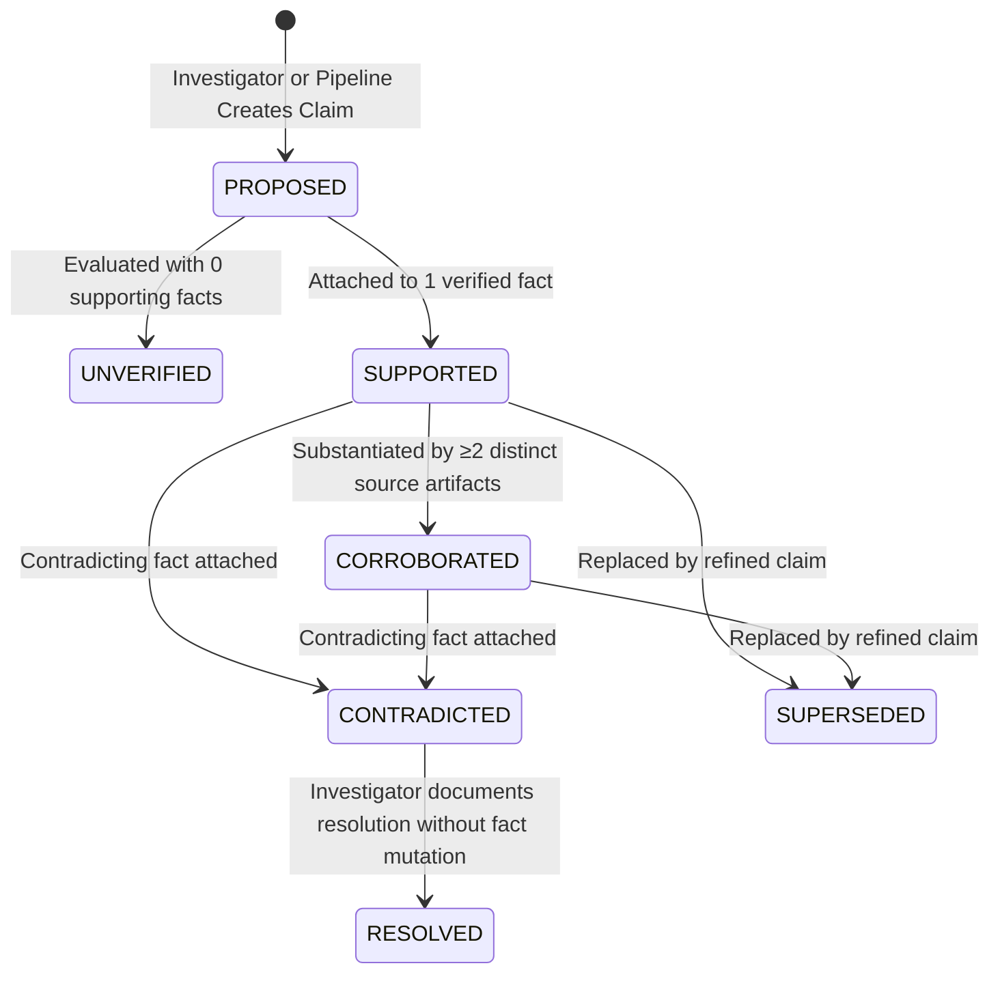

# SentinelX 2026 — Claim & Epistemic State Engine Specification
**Document ID**: `docs/reasoning/CLAIM_MODEL.md`  
**Milestone**: Wave 3 (Evidence Reasoning Core)  
**Status**: `VERIFIED & ARCHITECTURALLY FROZEN`  

---

## 1. Architectural Philosophy

In forensic criminal intelligence and legal proceedings (such as under the Indian Evidence Act / Bharatiya Sakshya Adhiniyam, 2023), raw evidence never speaks with absolute moral certainty. Automated systems that output binary labels like `TRUE`, `FALSE`, `GUILTY`, or `INNOCENT` are legally impermissible, ethically hazardous, and epistemologically invalid.

The SentinelX **Claim Engine** enforces a rigorous forensic epistemology:
1. **Claims are Interpretive Formulations**: A claim is an investigative assertion or inferential hypothesis derived from or attached to factual evidence.
2. **Strict Epistemic Status Hierarchy**:
   - `PROPOSED`: Newly formulated assertion awaiting fact attachment or corroboration.
   - `SUPPORTED`: Anchored to at least one verified evidence fact.
   - `CORROBORATED`: Independently substantiated across two or more separate source artifacts.
   - `CONTRADICTED`: In conflict with one or more verified facts or spatiotemporal realities.
   - `UNVERIFIED`: Lacks empirical support or fact grounding.
   - `RESOLVED`: Evaluated and closed by an authorized investigator.
   - `SUPERSEDED`: Replaced by a more granular or revised claim formulation.
3. **Strictly Avoid Accusatory Verdicts**: The engine rejects binary guilt labels. Association in a network does not constitute criminality.

---

## 2. Canonical EvidenceClaim Data Structure

Defined in [`backend/app/domain/canonical_evidence_ir.py`](file:///c:/PROJECTS/SentinelX/backend/app/domain/canonical_evidence_ir.py):

```python
class EvidenceClaim(BaseModel):
    claim_id: str = Field(default_factory=generate_uuid7)
    case_id: str
    assertion_text: str
    status: ClaimStatus = ClaimStatus.PROPOSED
    epistemic_status: EpistemicStatus = EpistemicStatus.INFERENCE
    supporting_fact_ids: List[str] = Field(default_factory=list)
    contradicting_fact_ids: List[str] = Field(default_factory=list)
    supporting_artifact_ids: List[str] = Field(default_factory=list)
    contradicting_artifact_ids: List[str] = Field(default_factory=list)
    source_reliability: SourceReliability = SourceReliability.B_USUALLY_RELIABLE
    corroboration: CorroborationLevel = CorroborationLevel.UNSPECIFIED
    confidence_score: float = 0.5
    analytical_method: str = "MULTI_SOURCE_GRAPH_REASONING"
    verified_by: Optional[str] = None
    verified_at: Optional[str] = None
    created_at: str = Field(default_factory=lambda: datetime.now(UTC).isoformat())
```

---

## 3. Claim Lifecycle & Evaluation Dynamics

Implemented in [`backend/app/services/claim_engine.py`](file:///c:/PROJECTS/SentinelX/backend/app/services/claim_engine.py):



### Deterministic State Evaluation Logic:
1. **Contradiction Dominance**: If `len(contradicting_facts) > 0`, status becomes `CONTRADICTED` and corroboration becomes `CONTRADICTED`.
2. **Multi-Artifact Corroboration**: If `len(distinct_artifacts) >= 2`, status becomes `CORROBORATED` with `corroboration = CORROBORATED` and confidence scaled up to 0.99.
3. **Single Source Support**: If `len(supporting_facts) >= 1`, status is `SUPPORTED` (`SINGLE_SOURCE`), confidence = 0.65.
4. **Zero Grounding**: Status is `UNVERIFIED`, confidence = 0.20.
5. **Source Reliability Aggregation**: Derived dynamically using NATO/Admiralty standards based on the highest reliability of underlying supporting facts.

---

## 4. Verification Proof

Verified by `test_claim_lifecycle_and_epistemic_statuses` in [`test_wave3_evidence_reasoning.py`](file:///c:/PROJECTS/SentinelX/backend/tests/test_wave3_evidence_reasoning.py):
- Proves status transition `PROPOSED` → `SUPPORTED` → `CORROBORATED` → `CONTRADICTED`.
- Asserts complete absence of strings `TRUE`, `FALSE`, `GUILTY`, and `INNOCENT`.
- Verifies backward compatibility combining supporting and contradicting facts through `fact_ids`.
