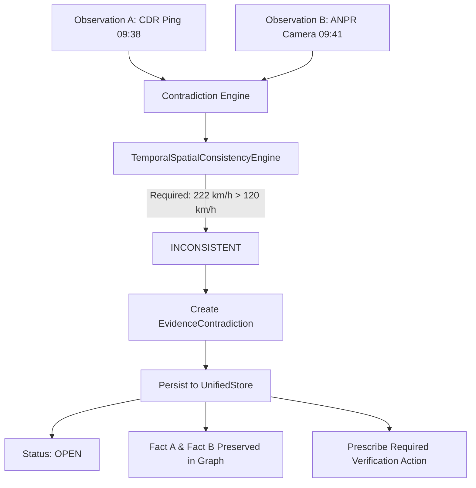

# SentinelX 2026 — Contradiction Engine Specification
**Document ID**: `docs/reasoning/CONTRADICTION_ENGINE.md`  
**Milestone**: Wave 3 (Evidence Reasoning Core)  
**Status**: `VERIFIED & ARCHITECTURALLY FROZEN`  

---

## 1. The Principle of Preserved Conflict

A catastrophic flaw in traditional analytical databases and automated correlation engines is **silent deduplication and automatic reconciliation**:
- If two sensors disagree on a suspect's location, selecting one over the other destroys defense exculpatory evidence or masks sensor spoofing/SIM cloning.
- If an alibi witness contradicts an automated toll camera, deleting the witness testimony violates legal disclosure rules (Brady material / Section 207 CrPC).
- If two name spellings appear ("Vikram Singh" vs "Bikram Sing"), merging them prematurely risks false arrest of an unrelated citizen.

**The Golden Law of SentinelX Contradiction Engine**:
> **Never silently resolve a contradiction.**  
> **Never choose one source as ground truth automatically.**  
> **Never delete, overwrite, or mutate either contradictory observation.**

---

## 2. Canonical EvidenceContradiction Data Structure

Defined in [`backend/app/domain/canonical_evidence_ir.py`](file:///c:/PROJECTS/SentinelX/backend/app/domain/canonical_evidence_ir.py):

```python
class EvidenceContradiction(BaseModel):
    contradiction_id: str = Field(default_factory=generate_uuid7)
    case_id: str
    claim_id: Optional[str] = None
    fact_a: str  # ID or reference to first fact
    fact_b: str  # ID or reference to conflicting fact
    contradiction_type: ContradictionType
    reason: str
    severity: ContradictionSeverity = ContradictionSeverity.HIGH
    detector: str = "TEMPORAL_SPATIAL_CONSISTENCY_ENGINE"
    detector_version: str = "1.0.0"
    uncertainty: float = 0.0
    status: str = "OPEN"  # OPEN, UNDER_VERIFICATION, RESOLVED, DISMISSED
    required_verification: str = ""
    created_at: str = Field(default_factory=lambda: datetime.now(UTC).isoformat())
    resolved_at: Optional[str] = None
```

### Contradiction Types:
1. `TEMPORAL`: Sequential timeline violation or causal order impossibility.
2. `SPATIAL`: Kinematic speed impossibility between two physical sightings.
3. `IDENTITY`: Discrepancy in identity attributes (passport, biometric, DOB, spelling variation).
4. `DOCUMENT`: Discrepancy between sworn statements, FIR narratives, and digital telemetry.
5. `SOURCE`: Conflicting reports from two independent agencies or intelligence sources.
6. `METADATA`: Inconsistency between file system metadata (mtime/ctime) and embedded headers.
7. `RELATIONSHIP`: Direct conflict in declared organizational or kinship ties.
8. `CHAIN_OF_CUSTODY`: Hash divergence, temporal inversion, or unauthorized custodian gap.

---

## 3. Operational Behavior

Implemented in [`backend/app/services/contradiction_engine.py`](file:///c:/PROJECTS/SentinelX/backend/app/services/contradiction_engine.py):



### Key Verification Prescriptions:
Instead of automated guessing, the engine formulates concrete investigative actions:
- *"Cross-verify location logs between 'CDR South Delhi Tower' and 'ANPR Sighting DND Toll'. Inspect physical toll / cell tower raw azimuth records."*
- *"Manual fingerprint or biometric Aadhaar de-duplication required before merging identities."*

---

## 4. Verification Proof

Verified in `test_contradiction_engine_detection_and_invariants` and `test_golden_case_wave3_full_reasoning_pipeline`:
- Asserts contradiction is registered with `status="OPEN"`.
- Asserts `resolved_at is None`.
- Asserts both contradictory facts remain present in `store.facts` and `store.relationships`.
