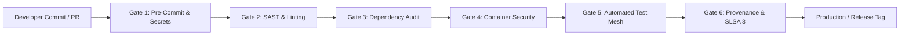

# TARKA DEVSECOPS CONTROL MATRIX & ASSURANCE GATES
## Continuous Security, Supply Chain Integrity, Automated Verification & SLSA Level 3

**Document Version:** 2.0.0  
**Classification:** Forensics Engineering / DevSecOps  
**Canonical Repository:** `C:\PROJECTS\SentinelX`  
**System Target:** TARKA × SENTINELX Forensic Intelligence Platform  
**Authority:** SentinelX Wave 6 Engineering Constitution  

---

## 1. Executive Summary & Quality Gates

The TARKA DevSecOps pipeline enforces automated, deterministic security gates across every phase of the software delivery lifecycle. Code cannot be merged into canonical branches or promoted to release tags without 100% automated pass rates across all gates.



---

## 2. DevSecOps Control Matrix

| Stage | Security Control | Tool / Mechanism | Pass / Fail Criteria | Blocking Action |
| :--- | :--- | :--- | :--- | :--- |
| **Code & Commit** | Secret Scanning | `Gitleaks` + `detect-secrets` | Zero high-entropy secrets, API keys, passwords, or private keys committed | Hard fail; commit blocked |
| | Commit Provenance | GPG / SSH Signed Commits | 100% of commits in release branches must be cryptographically signed | PR merge blocked |
| **Static Analysis** | Python SAST | `Bandit` (v1.7.9) | Zero High or Medium severity vulnerabilities (`-ll -ii`) | CI pipeline failure |
| | Multi-Language SAST | `Semgrep` (OWASP Top 10 rules) | Zero finding on SQLi, Command Injection, SSRF, Path Traversal | CI pipeline failure |
| | TypeScript / React SAST | `eslint-plugin-security` | Zero unvalidated DOM injection (`dangerouslySetInnerHTML`), zero prototype pollution | Frontend build failure |
| **Dependencies** | Python SCA | `pip-audit` + `safety` | Zero known CVEs with CVSS score $\ge 7.0$ in production dependency tree | Build failure |
| | Node.js SCA | `npm audit --production` | Zero Critical or High severity vulnerabilities | Build failure |
| | License Compliance | `pip-licenses` + `license-checker` | Rejects non-commercial or viral copyleft (GPL-3.0 in proprietary components) | Audit report flag |
| **Container Image**| Vulnerability Scanning | `Trivy` (v0.51.0) | Zero Critical or High OS/package CVEs with available patches | Container build blocked |
| | Base Image Hardening | `Distroless` / `Alpine Hardened` | Non-root user (`USER 10001`), read-only root filesystem, no shell in release container | Container run failure |
| **Runtime & Tests**| Invariant Test Mesh | `pytest` (Backend) | 100% pass on 44+ core forensic & security test suites | Merge blocked |
| | Frontend Verification | `vitest` + `tsc -b` | 100% pass on 148 Vitest suites; 0 TypeScript compilation errors | Merge blocked |
| **Supply Chain** | SBOM Generation | `Syft` (CycloneDX JSON) | Machine-readable Software Bill of Materials emitted for every release | Release packaging |
| | Provenance Attestation | `Cosign` / Sigstore | Cryptographic container image signature and SLSA Level 3 provenance metadata | Deployment gate |

---

## 3. Automated Security Gate Configurations

### 3.1 Python SAST (`bandit.yaml`)
```yaml
# TARKA Bandit SAST Configuration
skips: ['B101']  # Skip assert checks in test files only
tests:
  - B201 # flask_debug_true
  - B301 # pickle
  - B303 # md5
  - B307 # eval
  - B311 # random
  - B320 # xml_bad_cElementTree
  - B602 # subprocess_popen_with_shell_equals_true
  - B608 # hardcoded_sql_expressions
exclude_dirs:
  - 'venv'
  - '.venv'
  - 'tests'
  - 'frontend'
```

### 3.2 Secret Scanning (`.gitleaks.toml`)
```toml
[title]
title = "TARKA Custom Gitleaks Rules"

[rules]
[[rules]]
description = "Generic High-Entropy API Key"
regex = '''(?i)(api_key|apikey|secret|token|password|auth_token)\s*[:=]\s*['"][0-9a-zA-Z_\-]{16,}['"]'''
entropy = 3.5

[[rules]]
description = "Indian Bank API / PG Private Key"
regex = '''(?i)(hdfc_secret|icici_token|razorpay_key|paytm_mid)\s*[:=]\s*['"][0-9a-zA-Z]{12,}['"]'''
```

### 3.3 Container Security Hardening
Production container runtime requirements:
- Base image: `python:3.11-slim-bookworm` with all development packages purged.
- Execution user: `USER nonroot:nonroot` (`UID 10001`).
- Mounts: Root filesystem mounted as `read_only: true`. Temporary writes restricted to `/tmp` with `noexec,nosuid,nodev`.
- Capabilities: `cap_drop: [ALL]`. Zero Linux root capabilities permitted in production containers.
