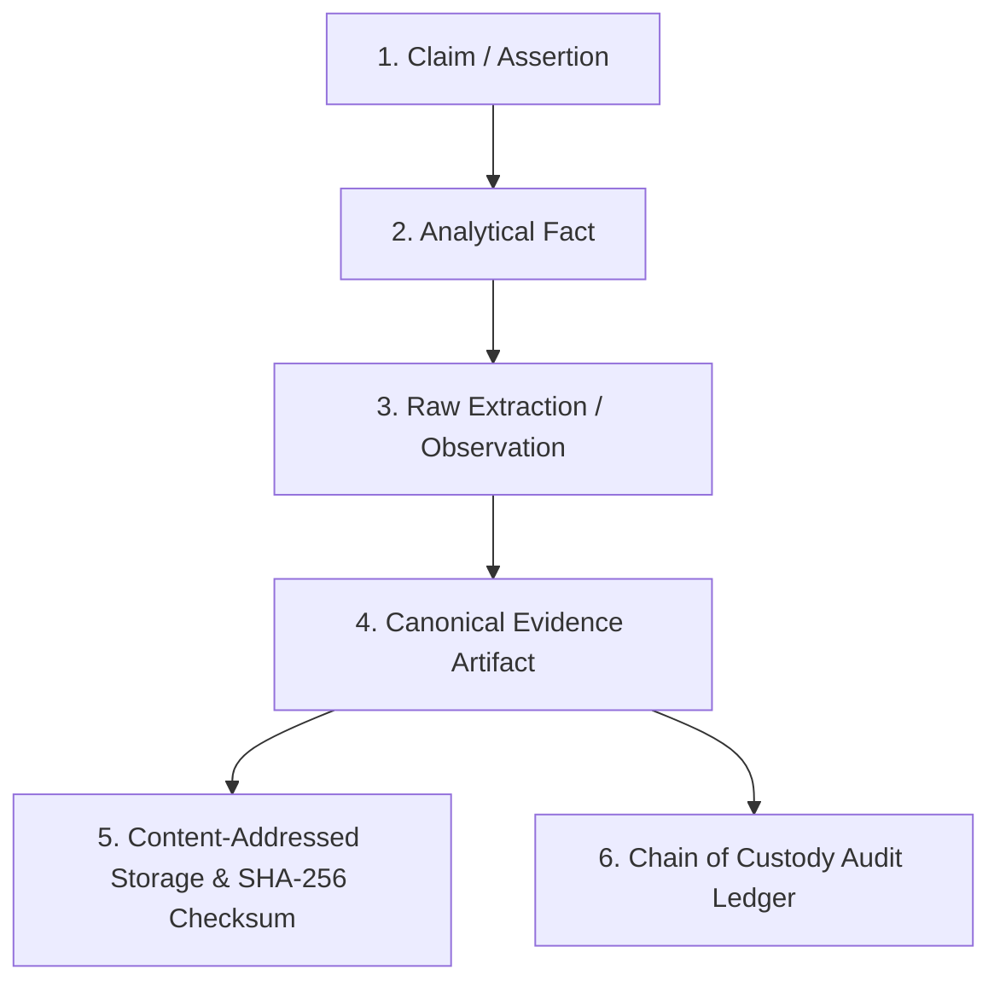

# Live Proof Projection & Cryptographic Lineage

## 1. Overview & Forensic Imperative

In digital forensics and criminal network analysis, a visualization or analytical inference is only as defensible as its raw cryptographic lineage. 

The **Live Proof Projection** provides on-demand verification of evidentiary claims by traversing the bidirectional lineage graph:
1. **Backward Lineage (`GET /api/v1/proof/{claim_id}`)**: From investigative claim down to the raw artifact SHA-256 hash.
2. **Forward Impact / Blast Radius (`GET /api/v1/proof/artifact/{artifact_id}`)**: From an ingested artifact up through all observations, facts, relationships, and claims derived from it.

---

## 2. Backward Lineage Chain

When an investigator clicks "LIVE PROOF" on any claim or fact, the LiveProofDrawer unpacks each step in the chain:

### Verification Checks:
- **Hash Integrity**: Artifact content re-hashed and compared against stored SHA-256 checksum.
- **Provenance Verification**: Source device, forensic tool, and operator recorded.
- **Custody Continuity**: Unbroken custody log with zero unauthenticated transfers.
- **Source Location Anchor**: Absolute file path or network URI preserved.

---

## 3. Statutory Compliance Certificate

The Live Proof Projection generates an automated compliance certificate verifying adherence to Indian evidentiary jurisprudence:
- **Section 65B Indian Evidence Act (IEA)**: Validates electronic device identification, hash integrity, uninterrupted machine operation, and custody certificate.
- **Section 63 Bharatiya Sakshya Adhiniyam (BSA) 2023**: Validates production, digital signature, and cryptographic hash chain for admissibility in modern court proceedings.
