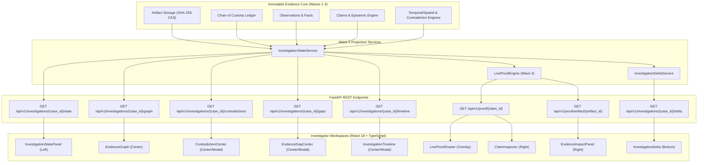

# Wave 4 Architecture: Evidence-Centric Intelligence Graph Projection & Investigation Workspaces

## 1. Executive Summary

SentinelX Wave 4 establishes the formal projection layer that transforms the immutable Canonical Evidence Information Representation (IR) and Wave 3 Evidence Reasoning Core into an investigator-facing, real-time intelligence workspace. 

Wave 4 strictly adheres to the principle that **the workspace UI and projection layer are never the source of truth**. All projections are computed deterministically from underlying content-addressed evidence artifacts, unbroken chain-of-custody logs, deterministic kinematic checks, and formal deductive proofs.

---

## 2. Core Architectural Invariants

1. **Pure Projection, Zero Evidence Mutation**:
   The projection layer and workspace components never write, mutate, overwrite, or delete underlying evidence facts, observations, artifacts, or custody records. All state modifications are append-only.

2. **Epistemic Separation Preserved**:
   The workspace UI strictly avoids conflating epistemic categories:
   - **Association $\neq$ Criminality**: Network adjacency or co-location does not imply criminal complicity or guilt.
   - **Centrality $\neq$ Guilt**: High graph degree, betweenness, or PageRank scores reflect observational density, not culpability.
   - **Similarity $\neq$ Identity**: Entity matches with confidence $< 1.0$ remain explicit candidate matches requiring human review; automated merging of ambiguous identities is prohibited.

3. **No Binary Guilt/Truth Labels**:
   Labels such as `TRUE`, `FALSE`, `GUILTY`, or `INNOCENT` are strictly forbidden throughout the backend schema, API responses, and frontend views. The system reports strictly through calibrated epistemic statuses:
   - `UNVERIFIED_OBSERVATION`
   - `PLAUSIBLE`
   - `CONTRADICTED`
   - `CORROBORATED`
   - `REFUTED`
   - `RETRACTED`

4. **Preservation of Contradictions and Gaps**:
   Contradictions (e.g., spatiotemporal kinematic impossibilities) and evidence gaps (e.g., missing Subscriber Acquisition Form/CAF records) are never silently resolved, hidden, or smoothed over. They are projected as top-level investigative anomalies in the Contradiction Center and Evidence Gap Center.

5. **Strict Append-Only Delta Semantics**:
   State differentials (`InvestigationDelta`) track claim status transitions, newly ingested observations, and emerging contradictions or gaps. In accordance with forensic audit standards, no entity or fact is ever reported as "deleted"; superseded claims explicitly document the rationale and new supporting artifacts.

6. **Statutory and Procedural Alignment**:
   All evidentiary summaries, timeline anchors, and live proof lineages provide direct statutory citations for Indian jurisprudence:
   - Electronic evidence certificates comply with **Section 65B Indian Evidence Act (IEA)** and **Section 63 Bharatiya Sakshya Adhiniyam (BSA) 2023**.
   - Procedural requisitions and gap-driven actions cite **Section 91 Code of Criminal Procedure (CrPC)** and **Section 94 Bharatiya Nagarik Suraksha Sanhita (BNSS) 2023**.

---

## 3. Component Architecture

---

## 4. Workspaces Verification

Wave 4 has been verified against Golden Case `CASE-2026-001` (Operation Triad Nexus) and automated regression suites:
- **Backend Suite**: 70/70 tests passing with zero failures.
- **Frontend Production Build**: Zero TypeScript compilation errors (`tsc -b && vite build`).
- **Cryptographic Lineage**: Unbroken backward and forward proof generation from raw artifact hash to claim state.
